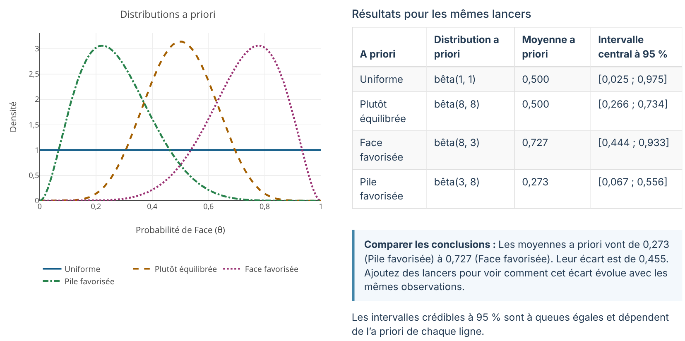
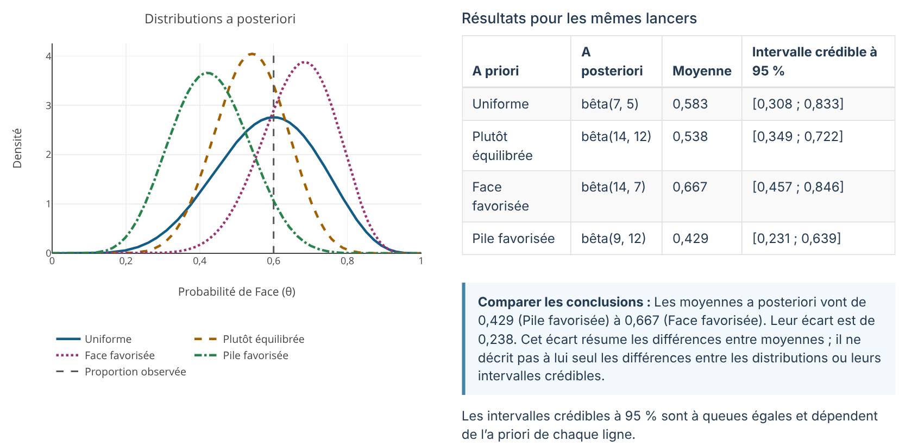

# Avant les lancers : l’a priori {#sec-apriori}

```{r}
#| include: false
source("_common.R")
tab_pr <- do.call(rbind, lapply(names(priors), function(nm) { ab <- priors[[nm]]; ci <- ic_beta(ab)
  data.frame(nm = nm, ab = beta_txt(ab), m = moyenne_beta(ab), s = sd_beta(ab), p46 = diff(pbeta(c(.4, .6), ab[1], ab[2])),
             p5 = pbeta(.5, ab[1], ab[2], lower.tail = FALSE), ci1 = ci[1], ci2 = ci[2], w = sum(ab) / (sum(ab) + 10)) }))
f10 <- H$faces[1]; n10 <- H$n[1]
post10 <- lapply(priors, posterieure, faces = f10, n = n10)
```

::: {.callout-tip title="Objectifs d’apprentissage"}
À la fin de ce chapitre, vous pourrez :

1. lire une distribution a priori et en tirer la probabilité d’un intervalle de valeurs de $\theta$ ;
2. décrire les quatre a priori de l’application par leur centre et leur dispersion ;
3. relier les paramètres $\alpha$ et $\beta$ d’une loi bêta à un nombre de « lancers fictifs » ;
4. expliquer pourquoi deux a priori de même moyenne n’ont pas la même influence.
:::

::: {.callout-important title="Idée centrale"}
Un a priori n’est pas une estimation : c’est une **distribution** qui répartit la plausibilité sur toutes les valeurs possibles de $\theta$ avant les lancers. Son centre dit où l’on penche ; sa dispersion dit avec quelle fermeté. Une loi bêta($\alpha$, $\beta$) se comporte comme si l’on avait déjà observé $\alpha + \beta$ lancers fictifs : plus ce nombre est grand, plus il faudra de vrais lancers pour la faire changer d’avis.
:::

Une distribution a priori décrit la façon dont on répartit les valeurs plausibles de $\theta$ avant les observations étudiées. Elle ne prédit pas le résultat exact d’une série : elle exprime une incertitude sur la probabilité de Face.

## Les quatre a priori de l’application

L’application propose quatre distributions bêta prédéfinies. Une loi bêta($\alpha$, $\beta$) a pour moyenne $\alpha/(\alpha+\beta)$ ; son écart-type mesure sa dispersion.

```{r}
#| label: tbl-apriori
#| tbl-cap: "Les quatre a priori prédéfinis de l’application."
knitr::kable(data.frame(`A priori` = tab_pr$nm, Distribution = tab_pr$ab, Moyenne = fmt(tab_pr$m), `É.-t.` = fmt(tab_pr$s),
  `95 % central` = paste0("[", fmt(tab_pr$ci1), " ; ", fmt(tab_pr$ci2), "]"),
  `Favorise` = c("Aucune valeur", "Les valeurs près de 0,5", "Les valeurs élevées", "Les valeurs faibles"),
  check.names = FALSE), align = "llrrcl", row.names = FALSE)
```

*É.-t.* : écart-type ; *95 % central* : intervalle qui laisse 2,5 % de la distribution a priori de chaque côté.

```{r}
#| label: fig-apriori
#| fig-cap: "Densités des quatre a priori prédéfinis."
#| fig-height: 3.6
x <- seq(0, 1, length.out = 501)
dpr <- do.call(rbind, lapply(names(priors), function(nm) data.frame(x = x, y = dbeta(x, priors[[nm]][1], priors[[nm]][2]), a = nm)))
dpr$a <- factor(dpr$a, levels = names(priors))
ggplot(dpr, aes(x, y, colour = a, linetype = a)) + geom_line(linewidth = 1.1) +
  scale_colour_manual(values = COUL, name = NULL) + scale_linetype_manual(values = c("solid", "dashed", "dotted", "dotdash"), name = NULL) +
  scale_x_continuous(labels = fmt_axe) + scale_y_continuous(labels = fmt_axe) +
  labs(x = "Probabilité de Face (θ)", y = "Densité") + guides(colour = guide_legend(nrow = 2))
```

La moyenne ne suffit pas à décrire une distribution. Uniforme et Plutôt équilibrée ont toutes deux une moyenne de 0,5, mais la seconde est beaucoup plus concentrée : son écart-type vaut `r nb(tab_pr$s[2])` contre `r nb(tab_pr$s[1])`. Leur influence sur la mise à jour diffère donc.

::: {.callout-note title="Densité et probabilité"}
Une densité uniforme ne signifie pas que la probabilité d’une valeur exacte de $\theta$ est positive : pour une distribution continue, les probabilités correspondent à des **aires sur des intervalles**. La hauteur d’une courbe peut d’ailleurs dépasser 1 : seule l’aire totale doit valoir 1.
:::

La règle utilisée par l’application pour générer une pièce mystère (une valeur uniforme entre 0,05 et 0,95) est distincte de l’a priori choisi pour l’analyser. Les a priori servent ici à explorer des points de départ ; ils ne décrivent pas nécessairement le mécanisme de génération de la pièce.

## Une distribution, pas une seule estimation

Supposons que vous jugiez plausible qu’une pièce soit presque équilibrée, sans en être certain. Dire « ma meilleure estimation est 0,5 » donne un point de départ, mais ne précise pas si des valeurs comme 0,4 ou 0,6 restent plausibles. Une distribution a priori ajoute cette information : elle décrit comment la plausibilité est répartie sur les valeurs possibles.

Pour lire une courbe, choisissez un intervalle, par exemple de 0,4 à 0,6. La probabilité a priori que $\theta$ appartienne à cet intervalle est l’aire sous la courbe entre ces deux bornes (@fig-aire).

```{r}
#| label: fig-aire
#| fig-cap: "Probabilité a priori de l’intervalle [0,4 ; 0,6] : l’aire colorée sous la courbe."
#| fig-height: 3.2
da <- subset(dpr, a %in% c("Uniforme", "Plutôt équilibrée"))
da$a <- factor(as.character(da$a), levels = c("Uniforme", "Plutôt équilibrée"),
  labels = c(paste0("Uniforme : ", pct(tab_pr$p46[1])), paste0("Plutôt équilibrée : ", pct(tab_pr$p46[2]))))
ggplot(da, aes(x, y)) + geom_area(data = subset(da, x >= .4 & x <= .6), fill = "#87bdd7", alpha = .7) +
  geom_line(colour = "#125c88", linewidth = 1) + facet_wrap(~ a, scales = "free_y") +
  scale_x_continuous(labels = fmt_axe) + scale_y_continuous(labels = fmt_axe) + labs(x = "θ", y = "Densité")
```

Avec l’a priori uniforme bêta(1, 1), la densité est constante entre 0 et 1. L’aire entre 0,4 et 0,6 vaut donc 0,2 : la probabilité a priori de cet intervalle est **20 %**. Les intervalles [0,1 ; 0,3] et [0,7 ; 0,9] ont la même largeur et, sous cet a priori, la même probabilité. Avec bêta(8, 8), le même intervalle reçoit `r pct(tab_pr$p46[2])` de la probabilité : la courbe y est plus haute.

## Même centre, dispersion différente

Comparez les distributions Uniforme et Plutôt équilibrée. Toutes deux sont symétriques autour de 0,5. Cependant, bêta(8, 8) accorde davantage de poids aux valeurs proches de 0,5 et moins aux valeurs extrêmes : elle traduit une conviction plus concentrée autour de l’équilibre.

Cette différence ne se limite pas à l’apparence du graphique. Dans la formule de la moyenne a posteriori (chapitre 2), le poids attribué à la moyenne a priori est

$$\frac{\alpha+\beta}{\alpha+\beta+n}.$$

Après 10 lancers, ce poids est $2/12 \approx `r nbm(100 * tab_pr$w[1], 1)`\,\%$ pour bêta(1, 1), mais $16/26 \approx `r nbm(100 * tab_pr$w[2], 1)`\,\%$ pour bêta(8, 8). Ce sont les poids **dans la formule de la moyenne**, pas des proportions de « confiance » applicables sans réserve à toutes les caractéristiques de la distribution.

Si les données sont exactement équilibrées, les deux moyennes a posteriori restent égales à 0,5, même si les distributions et les intervalles diffèrent. Il faut donc examiner la dispersion autant que le centre.

## Des lancers fictifs

Les paramètres d’une loi bêta ont une lecture simple : dans la moyenne a posteriori, un a priori bêta($\alpha$, $\beta$) pèse comme $\alpha + \beta$ lancers déjà observés, dont une proportion $\alpha/(\alpha+\beta)$ de Face. L’a priori uniforme pèse comme 2 lancers fictifs ; Plutôt équilibrée, comme 16 ; Face favorisée et Pile favorisée, comme 11.

Le choix **Personnalisé** de l’application permet de régler $\alpha$ et $\beta$ (de 0,5 à 500). Doubler $\alpha$ et $\beta$ conserve la moyenne mais double le nombre de lancers fictifs : bêta(50, 50) affirme avec beaucoup plus de fermeté que bêta(5, 5) que la pièce est équilibrée. Le chapitre 5 (mission 6) montre ce qu’il en coûte lorsque cette fermeté n’est pas justifiée.

## Deux directions opposées

L’a priori **Face favorisée**, bêta(8, 3), a une moyenne de $8/11 \approx `r nbm(tab_pr$m[3])`$ ; **Pile favorisée**, bêta(3, 8), de $3/11 \approx `r nbm(tab_pr$m[4])`$. Leurs courbes sont symétriques l’une de l’autre autour de 0,5. Avant tout lancer, le premier attribue une probabilité de `r pct(tab_pr$p5[3])` à $\theta > 0{,}5$ ; le second, de `r pct(tab_pr$p5[4])`.

Cela ne signifie pas que l’un de ces a priori est « vrai ». Dans l’application, ils permettent de poser une question de sensibilité : **qu’arrive-t-il aux conclusions si l’on part de points de vue différents et qu’on observe les mêmes données ?**

::: {.callout-note title="🖥️ Dans l’application"}
On peut changer la **Distribution a priori** à tout moment, y compris après les lancers : l’application réanalyse alors les mêmes données à partir d’un autre point de départ, sans relancer la pièce. L’onglet **Comparer les a priori** montre les quatre a priori prédéfinis côte à côte ; avant tout lancer, il affiche les distributions a priori elles-mêmes (@fig-app-comparer-apriori). Avec **Personnalisé**, la moyenne a priori et le nombre de lancers fictifs s’affichent sous les champs α et β.
:::

{#fig-app-comparer-apriori}

## Atelier guidé dans l’application {#sec-atelier-1}

1. Cliquez sur **Nouvelle expérience**, sans effectuer de lancer. Entrez 2026 dans **Graine (0 = au hasard)** et laissez **Probabilité connue** à 0,70.
2. Ouvrez **Comparer les a priori**. Quelles distributions ont la même moyenne ? Lesquelles sont centrées de part et d’autre de 0,5 ?
3. Effectuez 10 lancers. Comparez les moyennes et les intervalles du tableau (@fig-app-comparer-10). Les quatre lignes reposent-elles sur les mêmes données ?
4. Choisissez l’a priori **Personnalisé** avec α = 5 et β = 5, puis avec α = 50 et β = 50. Notez la moyenne a priori et le nombre de lancers fictifs affichés.

{#fig-app-comparer-10}

::: {.callout-tip collapse="true" title="Résultats de référence (graine 2026)"}
**Étape 2.** Uniforme et Plutôt équilibrée sont centrées sur 0,5 ; Face favorisée et Pile favorisée ont des moyennes de `r fmt(tab_pr$m[3])` et `r fmt(tab_pr$m[4])`.

**Étape 3.** Les 10 lancers donnent `r f10` Face et `r n10 - f10` Pile, pour les quatre lignes :

```{r}
knitr::kable(data.frame(`A priori` = names(priors), `A posteriori` = sapply(post10, beta_txt),
  Moyenne = sapply(post10, function(q) fmt(moyenne_beta(q))),
  `Intervalle crédible à 95 %` = sapply(post10, function(q) { ci <- ic_beta(q); paste0("[", fmt(ci[1]), " ; ", fmt(ci[2]), "]") }),
  check.names = FALSE), align = "llrr", row.names = FALSE)
```

Les moyennes vont de `r fmt(min(sapply(post10, moyenne_beta)))` à `r fmt(max(sapply(post10, moyenne_beta)))` : avec seulement 10 lancers, l’a priori pèse encore lourd.

**Étape 4.** Les deux a priori ont une moyenne de 0,500 ; ils pèsent comme 10 et 100 lancers fictifs.
:::

## Exercices

**Exercice 1.** Une distribution a priori uniforme est-elle « sans hypothèse » ?

**Exercice 2.** Avec l’a priori uniforme, quelle est la probabilité a priori que $\theta$ soit supérieure à 0,9 ? Que $\theta$ vaille exactement 0,5 ?

**Exercice 3.** Calculez la moyenne et le nombre de lancers fictifs de bêta(6, 2). Quelle idée exprime-t-il ?

**Exercice 4.** Après 40 lancers, quel est le poids de la moyenne a priori dans la moyenne a posteriori pour Uniforme et pour Plutôt équilibrée ?

::: {.callout-note collapse="true" title="Éléments de correction"}
1. Non. Elle accorde une densité égale à toutes les valeurs de $\theta$ entre 0 et 1, ce qui est déjà une façon précise de répartir les valeurs possibles. Dans une étude réelle, le choix d’un a priori demande à être expliqué, et la comparaison de plusieurs choix raisonnables aide à mesurer son influence.
2. L’aire entre 0,9 et 1 vaut 0,1, soit 10 %. La probabilité d’une valeur exacte est nulle pour une distribution continue : seule une aire sur un intervalle a une probabilité positive.
3. Moyenne $6/8 = 0{,}75$ ; 8 lancers fictifs. Il penche nettement vers Face, avec une fermeté modérée.
4. Uniforme : $2/42 \approx 4{,}8\,\%$. Plutôt équilibrée : $16/56 \approx 28{,}6\,\%$.
:::

::: {.callout-important title="À retenir"}
1. Un a priori est une distribution sur $\theta$, pas une valeur unique.
2. Les probabilités sont des aires sous la courbe ; la hauteur est une densité.
3. Une loi bêta($\alpha$, $\beta$) a pour moyenne $\alpha/(\alpha+\beta)$ et pèse comme $\alpha+\beta$ lancers fictifs.
4. Deux a priori de même moyenne peuvent avoir des influences très différentes.
5. Même l’a priori uniforme est un choix, qui doit être justifié.
:::

## Quiz

1. Sous l’a priori uniforme, la probabilité que $\theta$ soit entre 0,4 et 0,6 vaut :
   a) 0,5 ; b) 0,2 ; c) 0.
2. bêta(8, 8) et bêta(1, 1) ont :
   a) la même moyenne et la même dispersion ; b) la même moyenne, mais bêta(8, 8) est plus concentrée ; c) des moyennes différentes.
3. La moyenne de bêta(3, 8) est :
   a) 3/8 ; b) 3/11 ; c) 8/11.
4. Un a priori bêta(50, 50) pèse, dans la moyenne a posteriori, comme :
   a) 50 lancers fictifs ; b) 100 lancers fictifs ; c) aucun lancer.
5. La hauteur d’une densité a priori peut-elle dépasser 1 ?
   a) oui, seule l’aire totale vaut 1 ; b) non, c’est une probabilité ; c) seulement pour l’a priori uniforme.

::: {.callout-tip collapse="true" title="Réponses du quiz"}
1. **b.**
2. **b.**
3. **b.**
4. **b.**
5. **a.** La densité de bêta(8, 8) dépasse 3 près de 0,5.
:::
