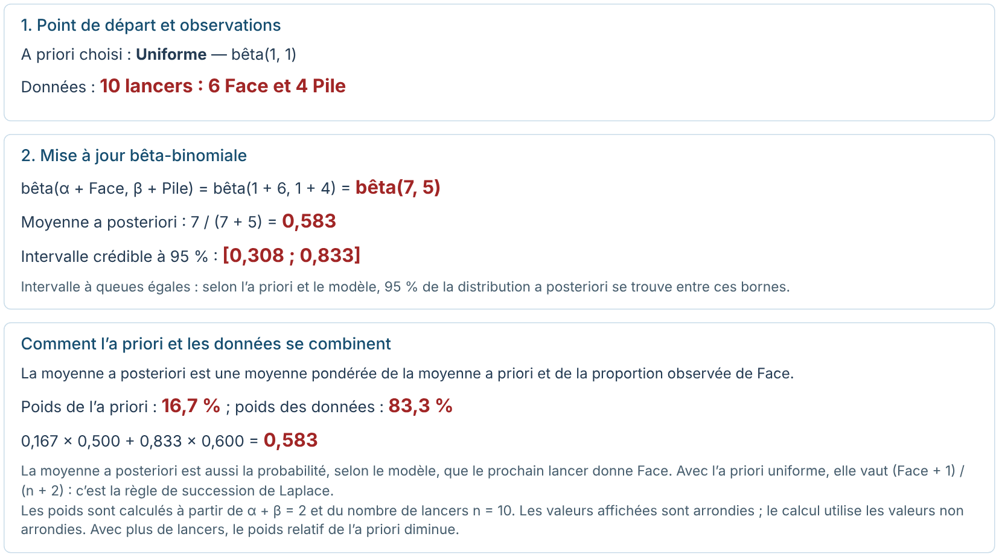
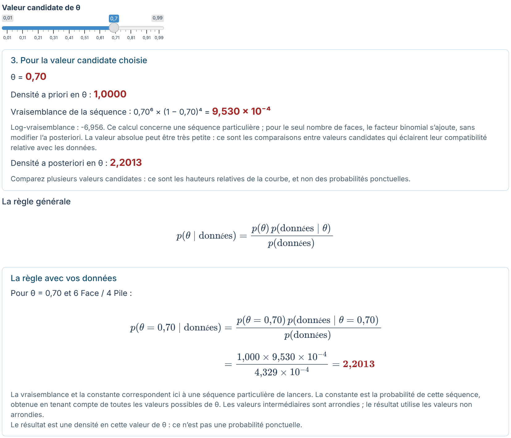

# Après les lancers : la mise à jour {#sec-mise-a-jour}

```{r}
#| include: false
source("_common.R")
L <- function(t, f, p) t^f * (1 - t)^p
f1 <- H$faces[1]; p1 <- H$n[1] - f1; f2 <- H$faces[2] - f1; p2 <- (H$n[2] - H$n[1]) - f2
u10 <- posterieure(priors[["Uniforme"]], f1, H$n[1]); u20 <- posterieure(priors[["Uniforme"]], H$faces[2], H$n[2])
e20 <- posterieure(priors[["Plutôt équilibrée"]], H$faces[2], H$n[2])
pD10 <- beta(u10[1], u10[2]) / beta(1, 1)
m6 <- experience(G, "connue", 0.80); m6$lancer(100); f6 <- m6$etat()$faces
```

::: {.callout-tip title="Objectifs d’apprentissage"}
À la fin de ce chapitre, vous pourrez :

1. calculer et comparer la vraisemblance de quelques valeurs candidates de $\theta$ ;
2. passer d’un a priori bêta($\alpha$, $\beta$) à l’a posteriori bêta($\alpha + F$, $\beta + P$) ;
3. écrire la moyenne a posteriori comme une moyenne pondérée et en calculer les poids ;
4. enchaîner des mises à jour sans compter deux fois les mêmes lancers ;
5. distinguer la probabilité prédictive du prochain lancer d’une probabilité sur $\theta$.
:::

::: {.callout-important title="Idée centrale"}
La mise à jour bayésienne multiplie, pour chaque valeur candidate de $\theta$, la densité a priori par la vraisemblance des données, puis remet l’aire totale à 1. Avec un a priori bêta, ce calcul se réduit à une addition : **les Face s’ajoutent à $\alpha$, les Pile à $\beta$**. La moyenne a posteriori est alors un compromis entre la moyenne a priori et la proportion observée, et le poids des données grandit avec le nombre de lancers.
:::

## La vraisemblance

Supposons que l’on observe $F$ Face et $P$ Pile, avec $n = F + P$. Pour une séquence particulière de lancers, la vraisemblance, considérée comme fonction de $\theta$, est

$$L(\theta) = \theta^F (1 - \theta)^P.$$

Elle permet de comparer la compatibilité des mêmes observations avec différentes valeurs candidates de $\theta$. Si l’on considère seulement le **nombre** de Face, la probabilité binomiale comprend en plus le coefficient $\binom{n}{F}$. Ce coefficient est constant en $\theta$ et ne change pas la distribution a posteriori.

### Comparer des valeurs candidates

Reprenons 7 Face et 3 Pile. Imaginons d’abord une séquence précise comportant ces résultats. Si la pièce a une probabilité de Face de 0,5, la probabilité de cette séquence est

$$L(0{,}5) = 0{,}5^7 (1 - 0{,}5)^3 \approx `r nbm(L(.5, 7, 3), 6)`.$$

Si la probabilité de Face vaut 0,7, celle de la même séquence est

$$L(0{,}7) = 0{,}7^7 (1 - 0{,}7)^3 \approx `r nbm(L(.7, 7, 3), 6)`.$$

Cette séquence est donc environ `r nb(L(.7, 7, 3) / L(.5, 7, 3), 2)` fois plus vraisemblable sous $\theta = 0{,}7$ que sous $\theta = 0{,}5$. Cela ne veut pas dire qu’il y a une probabilité de `r nb(L(.7, 7, 3) / L(.5, 7, 3), 2)` que $\theta = 0{,}7$, ni que ces deux valeurs sont les seules possibles. La vraisemblance compare les observations **pour des valeurs candidates fixées** ; l’a posteriori décrit une distribution sur l’ensemble des valeurs possibles de $\theta$.

```{r}
#| label: fig-vraisemblance
#| fig-cap: "Vraisemblance d’une séquence de 7 Face et 3 Pile. Elle culmine à la proportion observée, 0,7."
#| fig-height: 3.2
dv <- data.frame(t = seq(0, 1, length.out = 401)); dv$v <- 1000 * L(dv$t, 7, 3)
pts <- data.frame(t = c(.5, .7), v = 1000 * L(c(.5, .7), 7, 3))
pts$lab <- paste0("L(", fmt_axe(pts$t), ") ≈ ", fmt(pts$v / 1000, 6))
ggplot(dv, aes(t, v)) + geom_line(colour = "#125c88", linewidth = 1.1) +
  geom_segment(data = pts, aes(xend = t, y = 0, yend = v), linetype = "dashed", colour = "grey40") +
  geom_point(data = pts, size = 2.5, colour = "#a12626") +
  geom_text(data = pts, aes(label = lab), hjust = c(1.05, -0.05), vjust = -0.6, size = 3.4) +
  scale_x_continuous(labels = fmt_axe, breaks = seq(0, 1, .1)) + scale_y_continuous(labels = fmt_axe, expand = expansion(mult = c(.02, .15))) +
  labs(x = "Valeur candidate de θ", y = "Vraisemblance (× 1 000)")
```

Pourquoi les deux nombres sont-ils petits ? Nous avons calculé la probabilité d’une **séquence précise**, parmi de nombreuses séquences possibles. Si nous ne retenons que le nombre de Face, il existe $\binom{10}{7} = 120$ séquences différentes contenant 7 Face. Les probabilités du nombre de Face sont donc respectivement environ `r nb(dbinom(7, 10, .5), 4)` et `r nb(dbinom(7, 10, .7), 4)`. Leur rapport demeure le même : le facteur 120 intervient dans les deux calculs. Pour une longue séquence, la vraisemblance devient minuscule ; sa valeur absolue ne résume pas la force des conclusions, ce sont les **comparaisons** entre valeurs candidates qui comptent.

## Le théorème de Bayes

$$p(\theta \mid D) = \frac{p(\theta)\, p(D \mid \theta)}{p(D)}.$$

La distribution a posteriori est proportionnelle au produit de la densité a priori et de la vraisemblance. Dans cette formule, $p(\theta)$ et $p(\theta \mid D)$ sont des **densités**.

### Pourquoi multiplier par l’a priori ?

La vraisemblance répond à la question : « Si $\theta$ avait cette valeur, dans quelle mesure les données observées seraient-elles compatibles avec elle ? » L’a priori indique comment les valeurs de $\theta$ étaient réparties avant les données. Leur produit donne une première pondération des valeurs candidates.

Il reste à ajuster l’échelle : le dénominateur $p(D)$ est la probabilité des données calculée en tenant compte de toutes les valeurs possibles de $\theta$ et de leur répartition a priori. Il est le même pour chaque valeur candidate. Il transforme le produit en une densité dont l’aire totale est 1 ; il ne favorise donc aucune valeur candidate par rapport à une autre.

::: {.callout-note title="Attention à la notation"}
Pour une variable continue, l’écriture $p(\theta \mid D)$ désigne une **densité**. En une valeur précise, sa hauteur n’est pas la probabilité que $\theta$ soit exactement égal à cette valeur. Une probabilité se lit comme une aire sur un intervalle.
:::

### Le raccourci bêta-binomial

Avec un a priori bêta($\alpha$, $\beta$), le produit $\theta^{\alpha-1}(1-\theta)^{\beta-1} \times \theta^F (1-\theta)^P$ a encore la forme d’une loi bêta. L’a posteriori est donc

$$\theta \mid D \sim \operatorname{bêta}(\alpha + F,\, \beta + P).$$

On dit que la loi bêta est **conjuguée** à la vraisemblance binomiale : l’a priori et l’a posteriori appartiennent à la même famille, et la mise à jour se fait par simple addition. La @fig-trois-courbes montre ce compromis pour deux a priori et les mêmes 7 Face et 3 Pile. La courbe « vraisemblance » y est remise à l’échelle d’une densité, bêta(8, 4), pour être comparable aux deux autres.

```{r}
#| label: fig-trois-courbes
#| fig-cap: "A priori, vraisemblance (remise à l’échelle) et a posteriori pour 7 Face et 3 Pile. L’a posteriori se situe entre les deux autres courbes."
#| fig-height: 3.4
x <- seq(0, 1, length.out = 501)
d3 <- do.call(rbind, lapply(c("Uniforme", "Plutôt équilibrée"), function(nm) { ab <- priors[[nm]]; po <- posterieure(ab, 7, 10)
  rbind(data.frame(x = x, y = dbeta(x, ab[1], ab[2]), c = "A priori"), data.frame(x = x, y = dbeta(x, 8, 4), c = "Vraisemblance"),
        data.frame(x = x, y = dbeta(x, po[1], po[2]), c = "A posteriori")) |> transform(p = paste0(nm, " : ", beta_txt(ab), " → ", beta_txt(po))) }))
d3$c <- factor(d3$c, levels = c("A priori", "Vraisemblance", "A posteriori"))
ggplot(d3, aes(x, y, colour = c, linetype = c)) + geom_line(linewidth = 1.05) + facet_wrap(~ p) +
  scale_colour_manual(values = c("grey45", "#a45f00", "#125c88"), name = NULL) +
  scale_linetype_manual(values = c("dashed", "dotted", "solid"), name = NULL) +
  scale_x_continuous(labels = fmt_axe) + scale_y_continuous(labels = fmt_axe) + labs(x = "θ", y = "Densité")
```

## Suivre la mise à jour pas à pas

Partons de bêta(1, 1). Les 7 Face s’ajoutent au premier paramètre et les 3 Pile au second :

$$\operatorname{bêta}(1, 1) \quad\longrightarrow\quad \operatorname{bêta}(1 + 7,\, 1 + 3) = \operatorname{bêta}(8, 4).$$

La proportion observée est $7/10 = 0{,}70$ ; la moyenne a posteriori est $8/12 \approx 0{,}667$. Elle se situe entre la moyenne a priori, 0,5, et la proportion observée. Avec l’a priori bêta(8, 8), les mêmes observations donnent bêta(15, 11), de moyenne $15/26 \approx 0{,}577$ : les observations sont identiques, les points de départ diffèrent.

## Un compromis pondéré

Pour $n > 0$, la moyenne a posteriori s’écrit

$$\frac{\alpha+\beta}{\alpha+\beta+n} \cdot \frac{\alpha}{\alpha+\beta} + \frac{n}{\alpha+\beta+n} \cdot \frac{F}{n}.$$

C’est une moyenne pondérée de la moyenne a priori et de la proportion observée, avec les poids $(\alpha+\beta)/(\alpha+\beta+n)$ et $n/(\alpha+\beta+n)$. Pour l’exemple précédent :

$$\frac{2}{12} \times 0{,}5 + \frac{10}{12} \times 0{,}7 = \frac{1}{12} + \frac{7}{12} = \frac{8}{12} \approx 0{,}667.$$

L’a priori pèse ici pour $2/12$, soit environ 16,7 %, et les données pour $10/12$, soit environ 83,3 %, dans le calcul de **cette moyenne**. Sans observations, le second poids est nul et la proportion observée n’est pas définie. Pour un a priori fixé, le poids relatif des données augmente avec $n$ (@tbl-poids). Cette identité concerne la **moyenne** : elle ne suffit pas à décrire toute la forme de l’a posteriori.

```{r}
#| label: tbl-poids
#| tbl-cap: "Poids de la moyenne a priori dans la moyenne a posteriori, selon le nombre de lancers."
nn <- c(0, 10, 20, 50, 100, 320, 1000)
knitr::kable(data.frame(Lancers = nn,
  `Uniforme (α + β = 2)` = pct(2 / (2 + nn)), `Plutôt équilibrée (α + β = 16)` = pct(16 / (16 + nn)),
  `bêta(50, 50) (α + β = 100)` = pct(100 / (100 + nn)), check.names = FALSE), align = "rrrr")
```

## Ajouter des données par étapes

Supposons que les 10 lancers précédents soient suivis de 6 Face et 4 Pile. Les données cumulées sont alors 13 Face et 7 Pile. On peut mettre à jour l’a priori initial directement :

$$\operatorname{bêta}(1 + 13,\, 1 + 7) = \operatorname{bêta}(14, 8).$$

On peut aussi repartir de la première distribution a posteriori, bêta(8, 4), et ajouter les nouveaux résultats :

$$\operatorname{bêta}(8 + 6,\, 4 + 4) = \operatorname{bêta}(14, 8).$$

Les deux approches conduisent à la même distribution, et l’ordre des séries n’a pas d’importance. L’a posteriori après la première série joue le rôle d’a priori pour la deuxième : il faut toutefois ajouter **seulement les nouvelles observations** à cette étape. Ajouter à nouveau les 10 premiers lancers reviendrait à les compter deux fois.

La @fig-sequence suit cette mise à jour sur la séance de référence (graine 2026, a priori uniforme) : la courbe se déplace vers 0,70 et se resserre à chaque série.

```{r}
#| label: fig-sequence
#| fig-cap: "Distributions a posteriori successives de la séance de référence (graine 2026, a priori uniforme). La ligne verticale marque la probabilité réelle, 0,70."
#| fig-height: 3.4
etapes <- rbind(data.frame(n = 0, faces = 0), H)
ds <- do.call(rbind, lapply(seq_len(nrow(etapes)), function(i) { q <- posterieure(c(1, 1), etapes$faces[i], etapes$n[i])
  data.frame(x = x, y = dbeta(x, q[1], q[2]), e = paste0("n = ", etapes$n[i], " : ", beta_txt(q))) }))
ds$e <- factor(ds$e, levels = unique(ds$e))
ggplot(ds, aes(x, y, colour = e)) + geom_line(linewidth = 1) + geom_vline(xintercept = THETA, linetype = "dashed", colour = "grey30") +
  scale_colour_viridis_d(option = "D", end = .9, direction = -1, name = NULL) +
  scale_x_continuous(labels = fmt_axe) + scale_y_continuous(labels = fmt_axe) + labs(x = "θ", y = "Densité") +
  guides(colour = guide_legend(ncol = 2))
```

::: {.callout-note collapse="true" title="Question de vérification"}
Après bêta(8, 4), une nouvelle série donne 2 Face et 3 Pile. Quel est le nouvel a posteriori ?

On obtient bêta(10, 7), de moyenne $10/17 \approx `r nbm(10/17)`$. Les cinq nouveaux résultats sont ajoutés une seule fois.
:::

## Personnaliser l’a priori : que signifie son poids ?

Dans l’application, l’option **Personnalisé** permet de choisir $\alpha$ et $\beta$. La moyenne a priori est $\alpha/(\alpha+\beta)$ et la somme $\alpha+\beta$ détermine son poids dans la formule précédente. À moyenne égale, augmenter cette somme rend la distribution plus concentrée et lui donne davantage de poids relatif face à un nombre donné de lancers.

On dit parfois que cet a priori « pèse comme $\alpha+\beta$ lancers fictifs » (chapitre 1). C’est une **analogie utile pour la moyenne pondérée**, et non l’affirmation que ces lancers ont réellement eu lieu. D’autres conventions de décompte de pseudo-observations existent selon ce que l’on cherche à représenter ; il faut donc expliciter le sens donné ici à l’analogie.

Avec bêta(50, 50), la moyenne initiale est 0,5 et la somme des paramètres est 100. Après 100 lancers, la moyenne a priori et la proportion observée reçoivent chacune un poids de 50 %. Si ces 100 lancers produisent **exactement** 80 Face, alors :

$$\frac{50 + 80}{100 + 100} = 0{,}65.$$

Une pièce simulée avec $\theta = 0{,}80$ ne donne pas toujours exactement 80 Face en 100 lancers. Avec la graine 2026, par exemple, 100 lancers donnent `r f6` Face et la moyenne a posteriori vaut $(50 + `r f6`)/200 = `r nbm((50 + f6) / 200)`$. La mission 6 de l’application (chapitre 5) permet d’observer ce compromis, puis d’ajouter des données pour réduire le poids relatif de l’a priori.

## Prédire le prochain lancer

Après les observations, quelle est la probabilité que le prochain lancer donne Face ? Elle s’obtient en faisant la moyenne des probabilités $\theta$ possibles selon leur distribution a posteriori. Dans le modèle bêta-binomial utilisé ici, elle est égale à la moyenne a posteriori :

$$P(\text{Face au prochain lancer} \mid D) = \frac{\alpha + F}{\alpha + \beta + n}.$$

Avec 7 Face et 3 Pile et l’a priori uniforme, elle vaut donc $8/12 \approx 0{,}667$. Cette probabilité prédictive concerne un **résultat futur** ; elle diffère de $P(\theta > 0{,}5 \mid D)$, qui concerne la valeur inconnue de la probabilité de Face (chapitre 3).

Avec bêta(1, 1), la formule devient $(F + 1)/(n + 2)$ : c’est la **règle de succession de Laplace**. Sans lancer, elle donne 1/2. Après un premier Face, elle donne 2/3, et non 1 : une seule observation ne supprime pas l’incertitude.

::: {.callout-note title="🖥️ Dans l’application"}
L’onglet **Comprendre le calcul** reprend ce chapitre avec vos propres lancers (@fig-app-calcul-10) :

- **1. Point de départ et observations** et **2. Mise à jour bêta-binomiale** : l’addition $\alpha + F$, $\beta + P$, la moyenne et l’intervalle crédible ;
- **Comment l’a priori et les données se combinent** : les deux poids et la moyenne pondérée, avec la règle de Laplace ;
- **Valeur candidate de θ** : déplacez le curseur pour lire la densité a priori, la vraisemblance de la séquence et la densité a posteriori en une valeur de $\theta$ (@fig-app-calcul-candidat) ;
- **La règle avec vos données** : le théorème de Bayes avec les nombres, y compris le dénominateur $p(D)$.

La vraisemblance affichée concerne une séquence particulière. Comparez ses valeurs entre elles, puis observez la densité a posteriori : les deux ne sont pas identiques, car la seconde tient aussi compte de l’a priori et de la normalisation.
:::

{#fig-app-calcul-10}

{#fig-app-calcul-candidat}

::: {.callout-note title="Rappel : la graine"}
La graine se règle avant le premier lancer d’une expérience et s’affiche ensuite ; la valeur 0 demande une graine choisie au hasard. Pour retrouver la même série, il faut la même version de l’application, les mêmes réglages et la même suite de clics, notamment les tailles des séries (voir l’introduction). La graine facilite une démonstration commune, sans faire disparaître le caractère simulé des observations.
:::

## Atelier guidé dans l’application {#sec-atelier-2}

1. Cliquez sur **Nouvelle expérience**. Choisissez **Probabilité connue** à 0,70, entrez 2026 dans **Graine (0 = au hasard)**, laissez l’a priori **Uniforme** et lancez 10 fois.
2. Dans **Comprendre le calcul**, relevez l’a posteriori, la moyenne et les deux poids. Vérifiez la moyenne pondérée à la main.
3. Placez **Valeur candidate de θ** à 0,50, à 0,60, puis à 0,70. Notez la vraisemblance et la densité a posteriori. Laquelle des trois valeurs les données favorisent-elles ?
4. Ajoutez 10 lancers. Combien de Face et de Pile la deuxième série a-t-elle donné ? Vérifiez que l’ajout de cette seule série à l’a posteriori de l’étape 2 donne le nouvel a posteriori.
5. Sans relancer, choisissez l’a priori **Plutôt équilibrée**. Que deviennent l’a posteriori, la moyenne et le poids de l’a priori ?

::: {.callout-tip collapse="true" title="Résultats de référence (graine 2026)"}
**Étape 2.** `r f1` Face et `r p1` Pile : bêta(1 + `r f1`, 1 + `r p1`) = `r beta_txt(u10)`, moyenne `r fmt(moyenne_beta(u10))`. Poids : 16,7 % et 83,3 % ; $0{,}167 \times 0{,}500 + 0{,}833 \times 0{,}600 \approx `r nbm(moyenne_beta(u10))`$.

**Étape 3.**

```{r}
tc <- c(.5, .6, .7)
knitr::kable(data.frame(`θ` = fmt(tc, 2), `Vraisemblance de la séquence` = sapply(L(tc, f1, p1), function(v) {
    e <- floor(log10(v)); paste0(fmt(v / 10^e, 3), " × 10^−", -e, "^") }),
  `Densité a posteriori` = fmt(dbeta(tc, u10[1], u10[2]), 4), check.names = FALSE), align = "rrr")
```

La valeur 0,60, égale à la proportion observée, a la plus grande vraisemblance et la plus grande densité a posteriori (l’a priori uniforme ne change pas l’ordre). Le dénominateur $p(D)$ vaut `r fmt(pD10 * 1e4, 3)` × 10^−4^ : chaque densité a posteriori est la vraisemblance divisée par ce nombre.

**Étape 4.** La deuxième série donne `r f2` Face et `r p2` Pile (13 Face et 7 Pile au total, l’exemple du chapitre, mais dans l’ordre inverse). bêta(`r u10[1]` + `r f2`, `r u10[2]` + `r p2`) = `r beta_txt(u20)`, comme bêta(1 + 13, 1 + 7) ; moyenne `r fmt(moyenne_beta(u20))`.

**Étape 5.** `r beta_txt(e20)`, moyenne `r fmt(moyenne_beta(e20))`. Le poids de l’a priori passe à $16/36 \approx `r nbm(100 * 16 / 36, 1)`\,\%$ : la moyenne est tirée davantage vers 0,5.
:::

## Exercices

**Exercice 1.** Avec l’a priori bêta(2, 2), on observe 3 Face et 1 Pile. Donnez l’a posteriori, sa moyenne et les deux poids de la moyenne pondérée.

**Exercice 2.** Pour une séquence de 7 Face et 3 Pile, de combien la vraisemblance de $\theta = 0{,}6$ dépasse-t-elle celle de $\theta = 0{,}5$ ?

**Exercice 3.** Après bêta(8, 4), obtenu avec 7 Face et 3 Pile, quelqu’un ajoute les résultats **cumulés** de deux séries, 13 Face et 7 Pile, et obtient bêta(21, 11). Quelle est l’erreur ?

**Exercice 4.** Trois lancers donnent 3 Face. Quelle est la probabilité que le prochain lancer donne Face avec l’a priori uniforme ? Avec bêta(8, 8) ?

**Exercice 5.** Avec l’a priori Plutôt équilibrée, combien de lancers faut-il pour que le poids de l’a priori tombe sous 10 % ?

::: {.callout-note collapse="true" title="Éléments de correction"}
1. bêta(5, 3), moyenne $5/8 = 0{,}625$. Poids de l’a priori $4/8 = 50\,\%$ ; $0{,}5 \times 0{,}5 + 0{,}5 \times 0{,}75 = 0{,}625$.
2. $\dfrac{0{,}6^7 \times 0{,}4^3}{0{,}5^{10}} \approx `r nbm(L(.6, 7, 3) / L(.5, 7, 3), 2)`$.
3. Les 10 premiers lancers sont comptés deux fois. Il faut ajouter seulement la deuxième série (6 Face, 4 Pile) à bêta(8, 4), ou ajouter les données cumulées à l’a priori **initial** : dans les deux cas, bêta(14, 8).
4. Laplace : $(3 + 1)/(3 + 2) = 0{,}8$. Avec bêta(8, 8) : $11/19 \approx `r nbm(11/19)`$.
5. $16/(16 + n) < 0{,}10$ exige $n > 144$ : il faut au moins 145 lancers.
:::

::: {.callout-important title="À retenir"}
1. La vraisemblance compare des valeurs candidates de $\theta$ pour les mêmes données ; ses valeurs absolues importent peu.
2. A posteriori $\propto$ a priori $\times$ vraisemblance ; le dénominateur ne fait que normaliser.
3. Avec un a priori bêta($\alpha$, $\beta$), l’a posteriori est bêta($\alpha + F$, $\beta + P$).
4. La moyenne a posteriori est une moyenne pondérée de la moyenne a priori et de la proportion observée ; le poids des données croît avec $n$. Il faut aussi examiner la dispersion.
5. On peut mettre à jour par étapes, à condition de n’ajouter que les nouvelles observations.
6. La prévision du prochain lancer et la probabilité que $\theta$ dépasse un seuil répondent à deux questions distinctes.
:::

## Quiz

1. Avec l’a priori bêta(3, 5), on observe 4 Face et 6 Pile. L’a posteriori est :
   a) bêta(4, 6) ; b) bêta(7, 11) ; c) bêta(9, 9).
2. Le coefficient binomial $\binom{n}{F}$ :
   a) déplace l’a posteriori vers 0,5 ; b) ne change pas l’a posteriori ; c) double la vraisemblance.
3. Le dénominateur $p(D)$ du théorème de Bayes :
   a) favorise les valeurs centrales de $\theta$ ; b) est le même pour toutes les valeurs candidates ; c) vaut toujours 1.
4. Avec l’a priori uniforme et 20 lancers, le poids de l’a priori dans la moyenne a posteriori vaut :
   a) 2/22 ; b) 2/20 ; c) 1/2.
5. Après 1 Face en 1 lancer, la règle de Laplace donne pour le prochain lancer :
   a) 1 ; b) 1/2 ; c) 2/3.

::: {.callout-tip collapse="true" title="Réponses du quiz"}
1. **b.** 3 + 4 et 5 + 6.
2. **b.**
3. **b.**
4. **a.** Environ 9,1 %.
5. **c.**
:::
