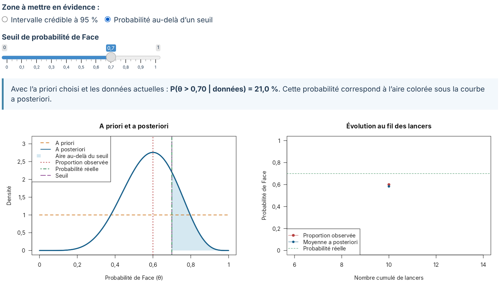
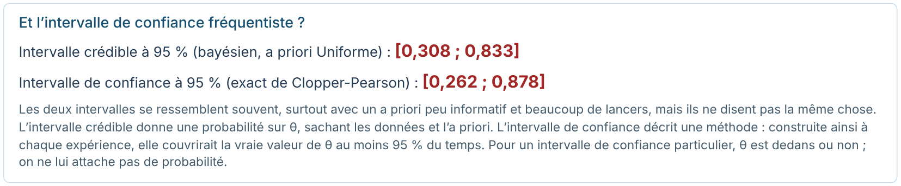
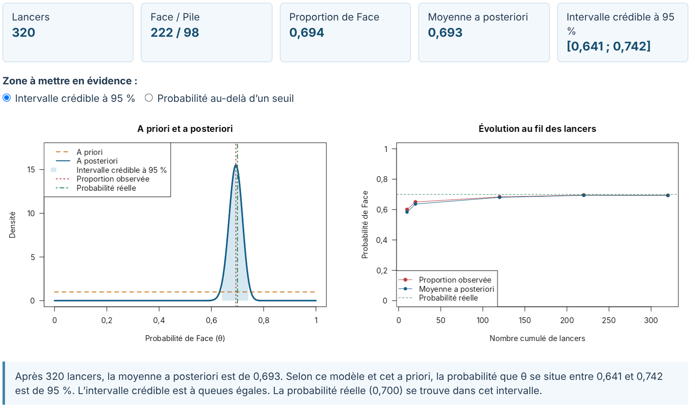

# Lire les résultats {#sec-interpreter}

```{r}
#| include: false
source("_common.R")
etat <- function(i, ab = c(1, 1)) posterieure(ab, H$faces[i], H$n[i])
q10 <- etat(1); ci10 <- ic_beta(q10); cp10 <- binom.test(H$faces[1], H$n[1])$conf.int
p70 <- pbeta(.7, q10[1], q10[2], lower.tail = FALSE); p50 <- pbeta(.5, q10[1], q10[2], lower.tail = FALSE)
q320 <- etat(5); ci320 <- ic_beta(q320)
hdi <- function(a, b, m = .95) { o <- optimize(function(p) qbeta(p + m, a, b) - qbeta(p, a, b), c(0, 1 - m)); qbeta(c(o$minimum, o$minimum + m), a, b) }
intv <- function(v, d = 3) paste0("[", fmt(v[1], d), " ; ", fmt(v[2], d), "]")
# Comparaison de l'atelier : pièce à 0,80, graine 2026
m8 <- experience(G, "connue", 0.80); m8$lancer(10); f8a <- m8$etat()$faces
for (k in 1:3) m8$lancer(100); f8b <- m8$etat()$faces
couv <- function(th, n) { f <- 0:n; pr <- dbinom(f, n, th)
  cr <- sapply(f, function(k) { ci <- qbeta(c(.025, .975), 1 + k, 1 + n - k); th >= ci[1] & th <= ci[2] })
  cpv <- sapply(f, function(k) { ci <- binom.test(k, n)$conf.int; th >= ci[1] & th <= ci[2] }); c(sum(pr * cr), sum(pr * cpv)) }
```

::: {.callout-tip title="Objectifs d’apprentissage"}
À la fin de ce chapitre, vous pourrez :

1. lire le graphique principal de l’application sans confondre densité et probabilité ;
2. interpréter un intervalle crédible à 95 % à queues égales ;
3. interpréter $P(\theta > s \mid D)$ et la distinguer de la probabilité du prochain Face ;
4. expliquer ce qui distingue un intervalle crédible d’un intervalle de confiance de Clopper-Pearson ;
5. lire le graphique d’évolution sans surinterpréter une série particulière.
:::

::: {.callout-important title="Idée centrale"}
Tous les résultats de l’application se lisent comme des **aires** sous la courbe a posteriori : l’intervalle crédible en laisse 2,5 % de chaque côté ; $P(\theta > s \mid D)$ est l’aire à droite du seuil. Ces nombres portent sur **$\theta$**, sachant le modèle, l’a priori et les données. Ils ne décrivent ni les lancers futurs, ni la fréquence à laquelle une méthode couvrirait la vraie valeur sur de nombreuses expériences.
:::

## Lire le graphique principal, étape par étape

Le graphique **A priori et a posteriori** de l’onglet **Explorer** réunit plusieurs informations. Commencez par les axes : l’axe horizontal représente les **valeurs possibles de $\theta$** ; l’axe vertical, une **densité**. Les hauteurs des courbes ne sont donc pas des probabilités ponctuelles.

- La **courbe a priori** montre le point de départ. Avant le premier lancer, l’a posteriori coïncide avec elle.
- La **courbe a posteriori** montre comment ce point de départ a été modifié par les lancers. Sa position indique où se concentrent les valeurs les plus plausibles selon le modèle ; sa largeur donne une idée de la dispersion.
- La **ligne de proportion observée** divise le nombre de Face par le nombre de lancers. Elle est calculée à partir des données seules ; la moyenne a posteriori tient aussi compte de l’a priori, et les deux ne coïncident donc pas nécessairement.
- La **ligne de probabilité réelle**, lorsque celle-ci est connue ou révélée, est un repère propre à la simulation. Elle ne fait pas partie des données : le calcul est le même que la pièce ait été révélée ou non. Dans une étude réelle, cette valeur est généralement inconnue.

### Une densité n’est pas une probabilité ponctuelle

Une courbe très concentrée peut dépasser la hauteur 1 : après les 320 lancers de la séance de référence, la densité a posteriori culmine à environ `r round(dbeta((q320[1] - 1) / (sum(q320) - 2), q320[1], q320[2]))` (@fig-app-explorer-320). Ce n’est pas une erreur. La probabilité d’un ensemble de valeurs de $\theta$ est **l’aire** sous la courbe correspondant à cet ensemble.

Pensez à une bande très étroite sous une courbe : une grande hauteur multipliée par une petite largeur peut produire une aire inférieure à 1. L’aire totale sous une densité est toujours égale à 1. Pour la distribution continue utilisée ici, la probabilité d’une valeur exacte, comme $\theta = 0{,}700000\ldots$, est nulle ; celle d’un intervalle autour de cette valeur peut être positive.

## L’intervalle crédible à 95 %

L’application présente un intervalle crédible à 95 % **à queues égales** : ses bornes sont les quantiles 2,5 % et 97,5 % de la distribution a posteriori. Il laisse donc 2,5 % de cette distribution dans chaque queue (@fig-aires, à gauche). Après les 10 premiers lancers de la séance de référence, l’application affiche `r intv(ci10)`. L’interprétation est :

> Compte tenu du modèle, de l’a priori uniforme et des données observées, la probabilité a posteriori que $\theta$ se situe entre `r fmt(ci10[1])` et `r fmt(ci10[2])` est de 95 %.

Cette affirmation porte sur la distribution de $\theta$, et non sur 95 % des lancers. Les bornes changent avec les données et peuvent changer lorsqu’on choisit un autre a priori.

```{r}
#| label: fig-aires
#| fig-cap: !expr paste0("Deux lectures de l’a posteriori ", beta_txt(q10), " (graine 2026, 10 lancers). À gauche, l’intervalle crédible à queues égales ; à droite, l’aire au-delà du seuil 0,70.")
#| fig-height: 3.2
x <- seq(0, 1, length.out = 801); y <- dbeta(x, q10[1], q10[2])
pa <- c("Intervalle crédible à 95 %", paste0("P(θ > 0,70 | D) = ", pct(p70)))
zone <- function(lo, hi, p, z) { xx <- seq(lo, hi, length.out = 300); data.frame(x = xx, y = dbeta(xx, q10[1], q10[2]), p = factor(p, levels = pa), z = z, g = paste(lo, hi)) }
dz <- rbind(zone(0, ci10[1], pa[1], "Queues de 2,5 %"), zone(ci10[2], 1, pa[1], "Queues de 2,5 %"),
            zone(ci10[1], ci10[2], pa[1], "Aire retenue"), zone(.7, 1, pa[2], "Aire retenue"))
dl <- rbind(data.frame(x = x, y = y, p = factor(pa[1], levels = pa)), data.frame(x = x, y = y, p = factor(pa[2], levels = pa)))
ggplot() + geom_area(data = dz, aes(x, y, fill = z, group = g), alpha = .8) +
  geom_line(data = dl, aes(x, y), colour = "#125c88", linewidth = 1) + facet_wrap(~ p) +
  scale_fill_manual(values = c("Aire retenue" = "#87bdd7", "Queues de 2,5 %" = "#d9a5a5"), name = NULL) +
  scale_x_continuous(labels = fmt_axe) + scale_y_continuous(labels = fmt_axe) + labs(x = "θ", y = "Densité")
```

Un intervalle à queues égales n’est pas le seul intervalle crédible possible ; c’est la règle de construction adoptée par l’application. Une autre règle retient l’**intervalle de plus haute densité**, le plus court qui contienne 95 % de la distribution. Pour une distribution presque symétrique, les deux se ressemblent : pour `r beta_txt(q10)`, l’intervalle de plus haute densité vaut `r intv(hdi(q10[1], q10[2]))`. Ils diffèrent davantage lorsque la distribution est asymétrique : après 3 Pile en 3 lancers avec l’a priori uniforme, bêta(1, 4) donne `r intv(ic_beta(c(1, 4)))` à queues égales, mais `r intv(hdi(1, 4))` en plus haute densité, qui inclut les valeurs proches de 0.

Lorsque vous ajoutez des lancers, l’intervalle a tendance à se resserrer, mais ses bornes peuvent se déplacer dans un sens ou dans l’autre selon les résultats (@tbl-seance). Une nouvelle série ne garantit pas que chaque changement observé aille dans la direction attendue.

## Probabilité au-delà d’un seuil

Dans **Explorer**, choisissez **Probabilité au-delà d’un seuil** sous **Zone à mettre en évidence :**, puis déplacez le curseur **Seuil de probabilité de Face**. L’aire colorée représente $P(\theta > s \mid D)$, où $s$ est le seuil choisi (@fig-app-explorer-seuil).

Après les 10 premiers lancers de la séance de référence, l’application indique $P(\theta > 0{,}70 \mid D) = `r nbm(100 * p70, 1)`\,\%$. Ce nombre est une probabilité **a posteriori concernant le paramètre** : selon le modèle, l’a priori et les observations, `r pct(p70)` de la distribution se situe au-delà de 0,70.

Ne confondez pas cette question avec « quelle est la probabilité que le prochain lancer donne Face ? ». Dans le modèle de l’application, cette seconde probabilité est la **moyenne a posteriori** (chapitre 2) : ici `r fmt(moyenne_beta(q10))`, alors que la probabilité que $\theta$ dépasse 0,70 vaut `r pct(p70)`.

Lorsque vous augmentez le seuil en gardant les mêmes données et le même a priori, l’aire à sa droite ne peut pas augmenter : l’ensemble des valeurs admissibles devient plus petit. Aux seuils 0 et 1, les probabilités valent respectivement 1 et 0 pour les distributions continues considérées ici.

{#fig-app-explorer-seuil}

::: {.callout-note collapse="true" title="Vérifiez votre compréhension"}
Si $P(\theta > 0{,}5 \mid D) = 0{,}90$, peut-on affirmer que le prochain lancer donnera Face avec une probabilité de 0,90 ?

Non. La valeur 0,90 indique quelle part de la distribution a posteriori est au-dessus de 0,5. La probabilité prédictive de Face est la moyenne de cette distribution ; il faut la consulter séparément. Après 20 lancers dans la séance de référence, par exemple, $P(\theta > 0{,}5 \mid D) = `r nbm(100 * pbeta(.5, etat(2)[1], etat(2)[2], lower.tail = FALSE), 1)`\,\%$, mais la probabilité du prochain Face vaut `r fmt(moyenne_beta(etat(2)))`.
:::

## Intervalle de confiance de Clopper-Pearson : une autre question

Dans **Comprendre le calcul**, l’application présente aussi un intervalle de confiance de Clopper-Pearson [@clopper1934] pour la probabilité de Face (@fig-app-frequentiste-10). Il est construit à partir des données selon une méthode fréquentiste exacte fondée sur le modèle binomial, sans utiliser l’a priori choisi pour l’analyse bayésienne.

| Intervalle | Construction | Interprétation |
|:--|:--|:--|
| Crédible bayésien à 95 % | Distribution a posteriori : modèle, données et a priori | Pour les données observées et l’a priori retenu, 95 % de la distribution a posteriori se trouvent dans l’intervalle. |
| Confiance de Clopper-Pearson à 95 % | Méthode binomiale appliquée aux données | Dans des répétitions indépendantes de la procédure, avec une probabilité vraie fixe, la méthode couvre cette valeur dans **au moins** 95 % des échantillons. |

: Deux intervalles, deux questions {#tbl-deux-intervalles}

La couverture de Clopper-Pearson est dite *conservatrice* : la proportion de couvertures peut dépasser 95 %, notamment parce que le nombre de Face est discret. Cette propriété décrit la procédure **avant** l’observation des données. Une fois un intervalle observé, il contient ou non la valeur fixe du modèle ; l’énoncé fréquentiste ne lui attribue pas une probabilité de 95 %.

Les deux intervalles se ressemblent souvent lorsque les données sont nombreuses et que l’a priori pèse peu (@tbl-seance) : après 10 lancers, `r intv(ci10)` contre `r intv(cp10)` ; après 320 lancers, ils ne diffèrent plus qu’au troisième chiffre. Cette ressemblance ne leur donne pas la même interprétation. Avec peu d’observations ou un a priori concentré, les différences sont plus visibles.

```{r}
#| label: tbl-seance
#| tbl-cap: "Séance de référence (graine 2026, a priori uniforme) : intervalles et probabilités au-delà d’un seuil."
knitr::kable(data.frame(Lancers = H$n,
  `Crédible à 95 %` = sapply(1:5, function(i) intv(ic_beta(etat(i)))),
  Largeur = sapply(1:5, function(i) fmt(diff(ic_beta(etat(i))))),
  `Clopper-Pearson` = sapply(1:5, function(i) intv(binom.test(H$faces[i], H$n[i])$conf.int)),
  `P(θ > 0,5)` = sapply(1:5, function(i) { v <- pbeta(.5, etat(i)[1], etat(i)[2], lower.tail = FALSE); if (v > .9995) "> 99,9 %" else pct(v) }),
  `P(θ > 0,7)` = sapply(1:5, function(i) pct(pbeta(.7, etat(i)[1], etat(i)[2], lower.tail = FALSE))),
  check.names = FALSE), align = "rcrcrr")
```

La dernière colonne illustre un point important : $P(\theta > 0{,}5 \mid D)$ approche 100 %, car il devient clair que la pièce favorise Face, mais $P(\theta > 0{,}7 \mid D)$ continue d’osciller. La valeur réelle étant exactement 0,70, la distribution a posteriori reste à peu près centrée sur ce seuil, et cette probabilité ne tend ni vers 0 ni vers 1.

{#fig-app-frequentiste-10}

## La valeur réelle est-elle dans l’intervalle ?

Dans une simulation, l’application indique sous le graphique si la probabilité utilisée pour générer les lancers se trouve dans l’intervalle crédible ou hors de celui-ci. Cette indication permet de comparer une conclusion à une valeur connue dans l’expérience.

Si la valeur réelle est à l’extérieur, cela ne prouve pas que le calcul est faux : un intervalle à 95 % n’a pas la propriété de couvrir la valeur de référence dans chaque expérience. S’il la contient, cela ne démontre pas non plus que toutes les hypothèses ou tous les choix d’a priori sont appropriés. Il s’agit du résultat d’une expérience particulière.

### Ce qu’une couverture veut dire

On peut toutefois **calculer** la proportion d’expériences dans lesquelles chaque méthode couvre une valeur fixée de $\theta$ : il suffit de passer en revue tous les nombres de Face possibles, pondérés par leur probabilité binomiale (@tbl-couverture).

```{r}
#| label: tbl-couverture
#| tbl-cap: "Proportion exacte d’expériences dans lesquelles l’intervalle contient la valeur réelle de θ (a priori uniforme pour l’intervalle crédible)."
grille <- expand.grid(th = c(.5, .7, .9), n = c(10, 20, 100))
cv <- t(mapply(couv, grille$th, grille$n))
knitr::kable(data.frame(Lancers = grille$n, `θ réel` = fmt(grille$th, 2),
  `Crédible à 95 %` = pct(cv[, 1]), `Clopper-Pearson` = pct(cv[, 2]), check.names = FALSE), align = "rrrr")
```

Clopper-Pearson atteint toujours au moins 95 %, comme le garantit sa construction. L’intervalle crédible, lui, peut descendre sous 95 % pour une valeur **fixée** de $\theta$ (`r pct(couv(.7, 10)[1])` pour $\theta = 0{,}7$ et 10 lancers) et la dépasser pour une autre. Sa garantie est d’une autre nature : **en moyenne sur les valeurs de $\theta$ tirées de l’a priori**, il couvre exactement 95 %. Pour une pièce mystère, tirée uniformément entre 0,05 et 0,95, l’intervalle crédible uniforme à 10 lancers couvre la vraie valeur dans environ 95,8 % des expériences.

::: {.callout-important title="Deux garanties différentes"}
La couverture d’une méthode fréquentiste, valable pour **chaque** valeur fixée de $\theta$, ne doit pas être automatiquement attribuée à un intervalle crédible. Celui-ci est calibré **en moyenne sur l’a priori**, à condition que l’a priori décrive bien la façon dont les valeurs de $\theta$ se présentent. Un a priori mal placé peut donc produire des intervalles qui manquent souvent la vraie valeur (voir l’atelier).
:::

## Observer l’évolution sans surinterpréter

Dans le graphique **Évolution au fil des lancers**, chaque point correspond à une série ajoutée : la proportion de Face et la moyenne a posteriori y sont cumulées (@fig-app-explorer-320). Les premières observations peuvent produire de grandes fluctuations ; plus tard, une série de taille fixe représente une fraction plus petite de l’ensemble des lancers et modifie souvent moins la proportion cumulée.

La moyenne a posteriori tend à suivre les données à mesure que leur poids relatif augmente. Elle peut cependant se déplacer dans un sens ou dans l’autre selon les nouveaux résultats : davantage de données ne signifie pas que chaque nouvelle série rapproche l’estimation de la valeur réelle. En changeant l’a priori, le graphique recalcule les moyennes de tout l’historique avec ce nouvel a priori : il s’agit d’une **comparaison rétrospective** des mêmes lancers, et non de nouvelles observations.

{#fig-app-explorer-320}

::: {.callout-note title="🖥️ Dans l’application"}
- **Explorer**, sous **Zone à mettre en évidence :** : **Intervalle crédible à 95 %** colore l’intervalle ; **Probabilité au-delà d’un seuil** affiche le curseur **Seuil de probabilité de Face** et la valeur de $P(\theta > s \mid \text{données})$.
- Le texte sous les graphiques résume la moyenne, l’intervalle et, si la probabilité réelle est connue ou révélée, indique si elle se trouve dans l’intervalle.
- **Comprendre le calcul**, section **Et l’intervalle de confiance fréquentiste ?** : l’intervalle crédible et l’intervalle de Clopper-Pearson côte à côte.
:::

## Atelier guidé dans l’application {#sec-atelier-3}

**Partie A : la séance de référence.**

1. Refaites la séance de référence jusqu’aux 10 premiers lancers : **Probabilité connue** à 0,70, graine 2026, a priori **Uniforme**. Notez l’intervalle crédible.
2. Choisissez **Probabilité au-delà d’un seuil**. Notez $P(\theta > s \mid D)$ pour les seuils 0,50 et 0,70, puis comparez avec la moyenne a posteriori.
3. Dans **Comprendre le calcul**, comparez l’intervalle crédible et l’intervalle de Clopper-Pearson.
4. Terminez la séance (10 lancers, puis trois séries de 100). La probabilité réelle est-elle toujours dans l’intervalle ? Choisissez ensuite l’a priori **Face favorisée** et observez le graphique d’évolution.

**Partie B : un a priori trop confiant.**

5. Cliquez sur **Nouvelle expérience**. Réglez **Probabilité réelle de Face** à 0,80, gardez la graine 2026 et l’a priori **Uniforme**, puis lancez 10 fois. Notez l’intervalle crédible et l’intervalle de Clopper-Pearson.
6. Sans relancer, choisissez **Personnalisé** avec α = 50 et β = 50. Quel intervalle change ?
7. Ajoutez trois séries de 100 lancers. Comparez les intervalles avec bêta(50, 50), avec l’a priori uniforme et de Clopper-Pearson. Lesquels contiennent 0,80 ?

::: {.callout-tip collapse="true" title="Résultats de référence (graine 2026)"}
**Étape 1.** `r intv(ci10)`.

**Étape 2.** $P(\theta > 0{,}50) = `r nbm(100 * p50, 1)`\,\%$ ; $P(\theta > 0{,}70) = `r nbm(100 * p70, 1)`\,\%$ ; moyenne (probabilité du prochain Face) `r fmt(moyenne_beta(q10))`.

**Étape 3.** Crédible `r intv(ci10)` ; Clopper-Pearson `r intv(cp10)`, plus large.

**Étape 4.** Oui, à chaque étape (@tbl-seance) ; au terme de la séance, `r intv(ci320)`. Avec Face favorisée, `r beta_txt(etat(5, priors[["Face favorisée"]]))`, moyenne `r fmt(moyenne_beta(etat(5, priors[["Face favorisée"]])))` : les premiers points de l’évolution changent nettement, les derniers à peine.

**Étapes 5 à 7.**

```{r}
ligne <- function(lab, f, n) { u <- posterieure(c(1, 1), f, n); b <- posterieure(c(50, 50), f, n)
  data.frame(Moment = lab, `Face / n` = paste0(f, " / ", n), `Uniforme` = intv(ic_beta(u)), `bêta(50, 50)` = intv(ic_beta(b)),
             `Clopper-Pearson` = intv(binom.test(f, n)$conf.int), check.names = FALSE) }
knitr::kable(rbind(ligne("10 lancers", f8a, 10), ligne("310 lancers", f8b, 310)), align = "lrccc")
```

Changer l’a priori modifie seulement l’intervalle crédible. Après 310 lancers, l’intervalle bêta(50, 50) **ne contient toujours pas 0,80** : un a priori équivalent à 100 lancers fictifs centrés sur 0,5 tire encore la distribution vers le bas. Les deux autres intervalles contiennent 0,80. Le calcul n’est pas faux ; c’est l’a priori qui est mal placé.
:::

## Exercices

**Exercice 1.** Quelle différence faites-vous entre une hauteur de densité et une aire sous la courbe ?

**Exercice 2.** Pourquoi la probabilité que $\theta$ dépasse 0,5 diffère-t-elle de la probabilité du prochain Face ?

**Exercice 3.** Si vous changez l’a priori sans changer les données, lequel des deux intervalles devrait demeurer identique ?

**Exercice 4.** Si la valeur réelle simulée tombe hors de l’intervalle crédible, que pouvez-vous conclure pour cette expérience ?

**Exercice 5.** Une personne affirme : « Mon intervalle crédible est [0,64 ; 0,74] ; donc, si je répétais l’expérience, 95 % de mes intervalles contiendraient la vraie valeur. » Qu’en pensez-vous ?

**Exercice 6.** Avec l’a posteriori `r beta_txt(q10)`, $P(\theta > 0{,}5 \mid D) = `r nbm(100 * p50, 1)`\,\%$. Que vaut $P(\theta \le 0{,}5 \mid D)$ ? Et $P(0{,}5 < \theta \le 0{,}7 \mid D)$ ?

::: {.callout-note collapse="true" title="Éléments de correction"}
1. La hauteur est une densité ; l’aire sur un intervalle est une probabilité.
2. La première concerne la valeur de $\theta$ ; la seconde prévoit un résultat futur et vaut la moyenne a posteriori dans ce modèle.
3. L’intervalle de Clopper-Pearson.
4. L’intervalle observé ne contient pas cette valeur ; ce constat seul ne démontre pas une erreur de calcul.
5. Elle attribue à l’intervalle crédible une propriété fréquentiste de couverture. L’intervalle crédible dit que 95 % de la distribution a posteriori est entre les bornes ; sa couverture pour une valeur fixée de $\theta$ peut être inférieure ou supérieure à 95 % (@tbl-couverture).
6. $1 - `r nbm(p50, 4)` = `r nbm(1 - p50, 4)`$. Par différence des aires : $`r nbm(p50, 4)` - `r nbm(p70, 4)` = `r nbm(p50 - p70, 4)`$.
:::

::: {.callout-important title="À retenir"}
1. Les hauteurs sont des densités ; les probabilités sont des aires.
2. L’intervalle crédible à queues égales laisse 2,5 % de l’a posteriori de chaque côté ; il porte sur $\theta$, pas sur les lancers.
3. $P(\theta > s \mid D)$ est une aire à droite du seuil ; elle ne donne pas la probabilité du prochain Face, qui est la moyenne a posteriori.
4. L’intervalle de Clopper-Pearson ne dépend pas de l’a priori et garantit au moins 95 % de couverture pour chaque $\theta$ ; l’intervalle crédible est calibré en moyenne sur l’a priori.
5. Une expérience particulière, réussie ou non, ne valide ni n’invalide à elle seule un calcul ou un a priori.
:::

## Quiz

1. L’intervalle crédible de l’application est délimité par :
   a) les quantiles 2,5 % et 97,5 % de l’a posteriori ; b) la moyenne ± 2 écarts-types ; c) les quantiles de l’a priori.
2. $P(\theta > 0{,}7 \mid D) = 0{,}21$ signifie que :
   a) le prochain lancer donnera Face avec une probabilité de 0,21 ; b) 21 % de la distribution a posteriori se trouve au-delà de 0,7 ; c) 21 % des lancers dépasseront 0,7.
3. Lorsqu’on augmente le seuil $s$, $P(\theta > s \mid D)$ :
   a) ne peut pas augmenter ; b) augmente ; c) reste constante.
4. On change l’a priori sans relancer. L’intervalle de Clopper-Pearson :
   a) se rétrécit ; b) ne change pas ; c) devient identique à l’intervalle crédible.
5. Dans la séance de référence, $P(\theta > 0{,}7 \mid D)$ ne tend pas vers 1 parce que :
   a) le calcul est approximatif ; b) la vraie valeur est exactement 0,70 ; c) l’a priori est uniforme.

::: {.callout-tip collapse="true" title="Réponses du quiz"}
1. **a.**
2. **b.**
3. **a.**
4. **b.**
5. **b.**
:::
