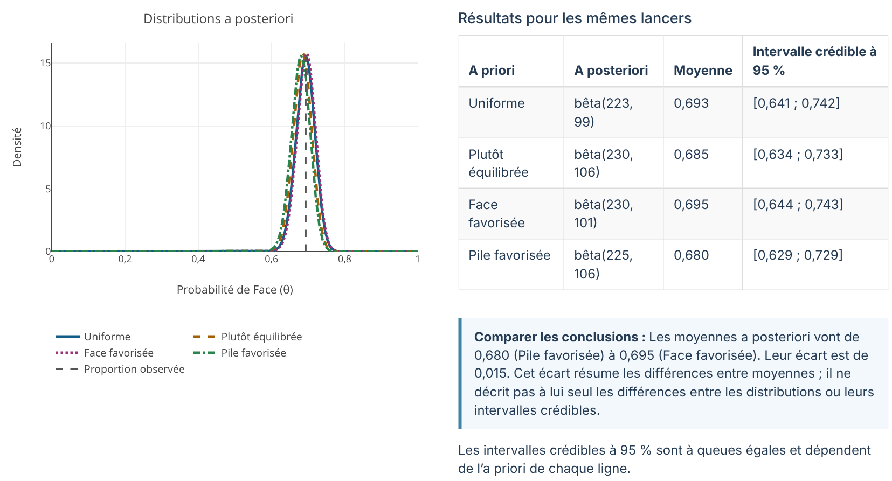
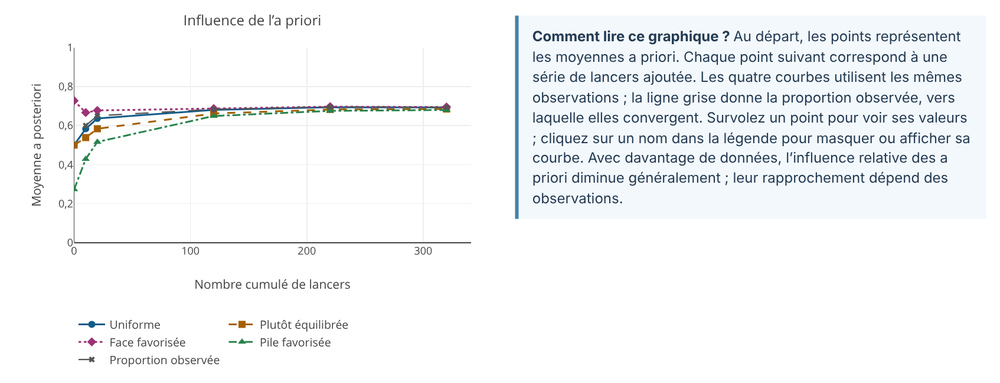

# Comparer les a priori {#sec-comparer}

```{r}
#| include: false
source("_common.R")
et <- rbind(data.frame(n = 0L, faces = 0L), H)
moy <- t(sapply(seq_len(nrow(et)), function(i) sapply(priors, function(ab) moyenne_beta(posterieure(ab, et$faces[i], et$n[i])))))
p5 <- t(sapply(seq_len(nrow(et)), function(i) sapply(priors, function(ab) { q <- posterieure(ab, et$faces[i], et$n[i]); pbeta(.5, q[1], q[2], lower.tail = FALSE) })))
ecart <- apply(moy, 1, function(v) diff(range(v)))
pct5 <- function(v) ifelse(v > .9995, "> 99,9 %", pct(v))
intv <- function(v) paste0("[", fmt(v[1]), " ; ", fmt(v[2]), "]")
ex <- lapply(priors, posterieure, faces = 7, n = 10)
```

::: {.callout-tip title="Objectifs d’apprentissage"}
À la fin de ce chapitre, vous pourrez :

1. expliquer pourquoi une comparaison d’a priori doit porter sur les mêmes lancers ;
2. lire ensemble le graphique, le tableau et le graphique d’évolution de l’onglet **Comparer les a priori** ;
3. décrire comment l’écart entre les conclusions diminue lorsque les lancers s’accumulent ;
4. distinguer une conclusion **sensible** au choix de l’a priori d’une conclusion **robuste** ;
5. présenter honnêtement une analyse de sensibilité.
:::

::: {.callout-important title="Idée centrale"}
Comparer plusieurs a priori sur les **mêmes données** est une analyse de sensibilité. Avec peu de lancers, les conclusions peuvent différer fortement selon le point de départ ; à mesure que les lancers s’accumulent, le poids de chaque a priori diminue et les conclusions se rapprochent. Une conclusion mérite confiance lorsqu’elle reste la même pour tous les a priori raisonnables.
:::

## Une même question, plusieurs points de départ

L’onglet **Comparer les a priori** met à jour les quatre a priori prédéfinis à partir des **mêmes observations**. Cette condition rend la comparaison instructive : les différences entre les distributions a posteriori proviennent des points de départ, et non de séries de lancers différentes.

La comparaison est une **analyse de sensibilité** : si plusieurs a priori raisonnables conduisent à des conclusions semblables, celles-ci sont peu sensibles à ce choix. Si les conclusions diffèrent, il est utile de comprendre pourquoi et de le signaler. Il ne s’agit pas d’élire la courbe qui correspond le mieux à une attente personnelle.

L’onglet ne porte que sur les quatre a priori prédéfinis : un a priori **Personnalisé** n’y apparaît pas. Pour l’étudier, choisissez-le dans la barre latérale et examinez ses résultats dans **Explorer** et **Comprendre le calcul** ; pour le comparer aux autres, changez ensuite d’a priori sans relancer la pièce.

## Avant les données : que voit-on ?

Cliquez sur **Nouvelle expérience** et ouvrez l’onglet avant le premier lancer. Puisqu’il n’y a pas encore d’observations, les distributions affichées sont les distributions a priori (@fig-app-comparer-apriori) :

- **Uniforme**, bêta(1, 1), répartit la densité également entre 0 et 1 ;
- **Plutôt équilibrée**, bêta(8, 8), concentre davantage la densité autour de 0,5 ;
- **Face favorisée**, bêta(8, 3), donne plus de poids aux valeurs élevées ;
- **Pile favorisée**, bêta(3, 8), donne plus de poids aux valeurs faibles.

Sur le graphique d’évolution, les points de départ sont les moyennes a priori. Uniforme et Plutôt équilibrée partent toutes deux de 0,5 : leurs points se superposent, même si leurs distributions sont différentes. Pour voir la différence, examinez aussi le premier graphique et le tableau.

::: {.callout-tip title="À observer"}
Avant d’ajouter des lancers, comparez Uniforme et Plutôt équilibrée. Leur moyenne identique masque une différence de concentration : observez la forme des courbes, puis les intervalles après quelques lancers.
:::

## Lire ensemble le graphique et le tableau

Après quelques lancers, le premier graphique superpose les distributions a posteriori ; une ligne indique la proportion observée de Face dans les données communes. À côté, chaque ligne du tableau donne l’a priori utilisé, les paramètres de la distribution mise à jour, sa moyenne et son intervalle crédible à 95 %.

Une courbe située plus à droite traduit des valeurs de $\theta$ généralement plus élevées ; une courbe plus concentrée, une dispersion plus faible. Il faut cependant éviter de juger la probabilité d’un intervalle à partir de la hauteur d’un point : une probabilité est une **aire** sous une courbe.

Sous le tableau, l’encadré **Comparer les conclusions** soustrait la plus petite moyenne de la plus grande. Ce résumé est utile, mais deux distributions peuvent avoir la même moyenne et des dispersions différentes. Regardez donc aussi les bornes des intervalles et la forme des courbes.

## Exemple : les mêmes 10 lancers

Supposons que les observations soient 7 Face et 3 Pile. Les mises à jour des quatre a priori sont les suivantes :

```{r}
#| label: tbl-exemple-710
#| tbl-cap: "Les quatre a priori mis à jour avec 7 Face et 3 Pile."
knitr::kable(data.frame(`A priori` = paste0(names(priors), " : ", sapply(priors, beta_txt)),
  `A posteriori` = sapply(ex, beta_txt), Moyenne = sapply(ex, function(q) fmt(moyenne_beta(q))),
  `Intervalle crédible` = sapply(ex, function(q) intv(ic_beta(q))),
  `Poids de l’a priori` = pct(sapply(priors, sum) / (sapply(priors, sum) + 10)), check.names = FALSE),
  align = "llrcr", row.names = FALSE)
```

La proportion observée est 0,700 dans les quatre cas. Les moyennes a posteriori vont pourtant de `r fmt(min(sapply(ex, moyenne_beta)))` à `r fmt(max(sapply(ex, moyenne_beta)))`. Avec ces 10 observations, le point de départ contribue encore beaucoup aux conclusions : l’a priori Pile favorisée tire la moyenne vers les valeurs faibles, tandis que Face favorisée commence déjà près de la proportion observée.

Ces valeurs décrivent l’exemple **fixé** à 7 Face et 3 Pile. Une expérience simulée de 10 lancers peut produire un autre résultat, même si la probabilité réelle est 0,70 : les 10 premiers lancers de la séance de référence (graine 2026) donnent `r H$faces[1]` Face, et le tableau correspondant de l’application est celui de la @fig-app-comparer-10.

## Lorsque les données s’accumulent

La moyenne a posteriori se trouve entre la moyenne a priori et la proportion observée. Pour chaque a priori, le poids de l’a priori dans cette moyenne diminue lorsque le nombre de lancers augmente. Les quatre moyennes tendent donc toutes vers la proportion observée, mais **à des vitesses différentes** : Plutôt équilibrée ($\alpha + \beta = 16$) résiste plus longtemps qu’Uniforme ($\alpha + \beta = 2$).

```{r}
#| label: tbl-ecart
#| tbl-cap: "Séance de référence (graine 2026) : moyennes a posteriori des quatre a priori et écart entre la plus grande et la plus petite."
knitr::kable(data.frame(Lancers = et$n, Proportion = c("—", fmt(H$faces / H$n)),
  Uniforme = fmt(moy[, 1]), `Plutôt équilibrée` = fmt(moy[, 2]), `Face favorisée` = fmt(moy[, 3]), `Pile favorisée` = fmt(moy[, 4]),
  Écart = fmt(ecart), check.names = FALSE), align = "rrrrrrr")
```

L’écart passe de `r fmt(ecart[1])` avant les lancers à `r fmt(ecart[6])` après 320 lancers (@tbl-ecart, @fig-quatre-posterieures). Rien ne garantit toutefois qu’il diminue **à chaque clic** : la proportion observée change elle aussi avec les nouvelles données. Le rapprochement est une tendance générale ; les courbes ne deviennent pas pour autant identiques.

::: {.callout-note title="Un cas particulier instructif"}
Face favorisée, bêta(8, 3), et Pile favorisée, bêta(3, 8), ont la même somme $\alpha + \beta = 11$. Après $n$ lancers dont $F$ Face, la différence de leurs moyennes vaut

$$\frac{8 + F}{11 + n} - \frac{3 + F}{11 + n} = \frac{5}{11 + n}.$$

Elle **ne dépend pas des résultats** : `r fmt(5/21)` après 10 lancers, `r fmt(5/331)` après 320, quelle que soit la pièce. Pour deux a priori de poids différents, comme Uniforme et Plutôt équilibrée, l’écart dépend en revanche de la proportion observée : il est nul si celle-ci vaut exactement 0,5.
:::

```{r}
#| label: fig-quatre-posterieures
#| fig-cap: "Les quatre distributions a posteriori après 10 et après 320 lancers de la séance de référence (graine 2026). Les mêmes données, des points de départ différents : l’écart se réduit nettement."
#| fig-height: 3.4
x <- seq(0, 1, length.out = 801)
dq <- do.call(rbind, lapply(c(1, 5), function(i) do.call(rbind, lapply(names(priors), function(nm) { q <- posterieure(priors[[nm]], H$faces[i], H$n[i])
  data.frame(x = x, y = dbeta(x, q[1], q[2]), a = nm, e = paste0(H$n[i], " lancers")) }))))
dq$a <- factor(dq$a, levels = names(priors)); dq$e <- factor(dq$e, levels = unique(dq$e))
ggplot(dq, aes(x, y, colour = a, linetype = a)) + geom_line(linewidth = 1) + facet_wrap(~ e, scales = "free_y") +
  geom_vline(xintercept = THETA, colour = "grey40", linetype = "dashed") +
  scale_colour_manual(values = COUL, name = NULL) + scale_linetype_manual(values = c("solid", "dashed", "dotted", "dotdash"), name = NULL) +
  scale_x_continuous(labels = fmt_axe) + scale_y_continuous(labels = fmt_axe) + labs(x = "θ", y = "Densité") +
  guides(colour = guide_legend(nrow = 2))
```

::: {.callout-note collapse="true" title="Question de compréhension"}
Deux a priori produisent après quelques lancers la même moyenne a posteriori. Peut-on conclure que leurs distributions sont identiques ?

Non. Elles peuvent avoir des dispersions ou des formes différentes. Comparez leurs intervalles crédibles et leurs courbes, en plus de leurs moyennes.
:::

## Conclusions sensibles, conclusions robustes

La question qui compte n’est pas seulement « les moyennes diffèrent-elles ? », mais « **la conclusion change-t-elle ?** ». Supposons que l’on veuille savoir si la pièce favorise Face, c’est-à-dire évaluer $P(\theta > 0{,}5 \mid D)$. On obtient cette probabilité pour chaque a priori en le choisissant dans la barre latérale puis en lisant **Probabilité au-delà d’un seuil** dans **Explorer**, avec le seuil 0,5.

```{r}
#| label: tbl-sensibilite
#| tbl-cap: "Séance de référence (graine 2026) : probabilité a posteriori que la pièce favorise Face, selon l’a priori."
sel <- 2:4
knitr::kable(data.frame(Lancers = et$n[sel], Uniforme = pct5(p5[sel, 1]), `Plutôt équilibrée` = pct5(p5[sel, 2]),
  `Face favorisée` = pct5(p5[sel, 3]), `Pile favorisée` = pct5(p5[sel, 4]), check.names = FALSE), align = "rrrrr")
```

Après 10 lancers, la réponse dépend fortement du point de départ : de `r pct(p5[2, 4])` avec Pile favorisée à `r pct(p5[2, 3])` avec Face favorisée. La conclusion est **sensible** à l’a priori ; il serait trompeur de rapporter un seul de ces nombres. Après 120 lancers, les quatre a priori donnent une probabilité supérieure à 99,9 % : la conclusion « la pièce favorise Face » est **robuste**. En revanche, une question plus fine, comme « $\theta$ dépasse-t-elle 0,70 ? », peut rester sensible bien plus longtemps.

::: {.callout-tip title="Présenter une analyse de sensibilité"}
1. Justifiez l’a priori principal.
2. Rapportez les résultats obtenus avec quelques autres a priori raisonnables, dont un peu informatif.
3. Indiquez si la conclusion change. Si elle change, dites-le : c’est une information sur la quantité de données disponibles, pas un échec de l’analyse.
:::

## Suivre les courbes dans le temps

Chaque point du graphique **Influence de l’a priori** correspond à un cumul de lancers (@fig-app-comparer-evolution-320). La ligne grise donne la proportion observée, vers laquelle les quatre courbes convergent. Survolez un point pour lire le nombre de lancers, la moyenne correspondante et les nombres de Face et de Pile.

Les graphiques de cet onglet sont interactifs. Cliquez sur un nom dans la légende pour masquer ou réafficher une courbe ; double-cliquez pour l’isoler, puis double-cliquez de nouveau pour rétablir les autres. La barre d’outils permet le zoom et l’enregistrement du graphique. Une courbe masquée ne disparaît que de l’affichage : les données et le tableau ne sont pas modifiés.

{#fig-app-comparer-320}

{#fig-app-comparer-evolution-320}

## Un a priori très confiant

Un a priori personnalisé bêta(50, 50) est centré sur 0,5 et beaucoup plus concentré que les quatre a priori prédéfinis : sa somme de paramètres vaut 100. Après 100 lancers, il représente encore la moitié du poids dans la moyenne a posteriori (chapitre 2). Le chapitre 3 a montré qu’avec une pièce à 0,80, son intervalle crédible exclut encore 0,80 après 310 lancers.

Un a priori concentré ralentit le déplacement des conclusions lorsque les données vont dans une autre direction. Cela ne le rend pas automatiquement illégitime : tout dépend de la justification du point de départ et de la question étudiée. Si l’on a de bonnes raisons de croire qu’une pièce est presque équilibrée, un a priori concentré est approprié. En revanche, la sensibilité des résultats à ce choix doit être examinée et présentée clairement. La mission 6 (chapitre 5) y revient.

::: {.callout-note title="🖥️ Dans l’application"}
- **Comparer les a priori** : graphique des distributions (a priori avant tout lancer, a posteriori ensuite), tableau **Résultats pour les mêmes lancers**, encadré **Comparer les conclusions** avec l’écart entre les moyennes.
- **Évolution des moyennes a posteriori** : le graphique **Influence de l’a priori**, avec les quatre moyennes et la proportion observée à chaque série.
- Les graphiques sont interactifs : survol, légende cliquable, zoom.
- L’a priori choisi dans la barre latérale n’influence pas cet onglet ; il détermine les résultats d’**Explorer** et de **Comprendre le calcul**.
:::

## Atelier guidé dans l’application {#sec-atelier-4}

1. Cliquez sur **Nouvelle expérience**. **Probabilité connue** à 0,70, graine 2026. Ouvrez **Comparer les a priori** avant tout lancer : quelles courbes ont la même moyenne ? Que montre le graphique d’évolution ?
2. Lancez 10 fois. Notez l’écart affiché dans **Comparer les conclusions**. Vérifiez la formule $5/(11 + n)$ pour l’écart entre Face favorisée et Pile favorisée.
3. Pour chacun des quatre a priori, choisi dans la barre latérale, lisez $P(\theta > 0{,}5 \mid D)$ dans **Explorer** (**Probabilité au-delà d’un seuil**, seuil 0,5). La conclusion « la pièce favorise Face » est-elle robuste ?
4. Terminez la séance (10 lancers, puis trois séries de 100) et refaites l’étape 3.
5. Dans **Influence de l’a priori**, isolez Pile favorisée par un double-clic sur son nom dans la légende, puis survolez ses points.

::: {.callout-tip collapse="true" title="Résultats de référence (graine 2026)"}
**Étape 1.** Uniforme et Plutôt équilibrée (0,500) ; leurs points de départ se superposent. Face favorisée part de `r fmt(moy[1, 3])`, Pile favorisée de `r fmt(moy[1, 4])`.

**Étape 2.** Écart `r fmt(ecart[2])`, entre Pile favorisée (`r fmt(moy[2, 4])`) et Face favorisée (`r fmt(moy[2, 3])`) ; $5/21 \approx `r nbm(5/21)`$.

**Étape 3.** De `r pct(p5[2, 4])` (Pile favorisée) à `r pct(p5[2, 3])` (Face favorisée) : la conclusion est sensible à l’a priori (@tbl-sensibilite).

**Étape 4.** Plus de 99,9 % pour les quatre a priori ; l’écart entre les moyennes vaut `r fmt(ecart[6])` (@tbl-ecart).

**Étape 5.** Pile favorisée : `r paste(fmt(moy[, 4]), collapse = " ; ")` pour 0, 10, 20, 120, 220 et 320 lancers.
:::

## Exercices

**Exercice 1.** Pourquoi faut-il conserver les mêmes lancers lorsqu’on compare des a priori ?

**Exercice 2.** Deux courbes commencent à la même moyenne. Quels autres éléments comparer ?

**Exercice 3.** Pourquoi bêta(50, 50) peut-il encore influencer fortement la moyenne après 100 lancers ?

**Exercice 4.** Le résultat de 7 Face sur 10 sera-t-il forcément obtenu avec une pièce dont la probabilité réelle est 0,70 ?

**Exercice 5.** Combien de lancers faut-il pour que l’écart entre les moyennes de Face favorisée et de Pile favorisée soit inférieur à 0,05 ? Cette réponse dépend-elle de la pièce ?

**Exercice 6.** Après 10 lancers donnant exactement 5 Face, que vaut l’écart entre les moyennes d’Uniforme et de Plutôt équilibrée ? Leurs intervalles crédibles sont-ils identiques ?

::: {.callout-note collapse="true" title="Éléments de correction"}
1. Pour attribuer les différences observées aux points de départ plutôt qu’à des séries différentes.
2. La dispersion, la forme et les intervalles crédibles.
3. Parce que la somme de ses paramètres vaut 100 : il reçoit alors la moitié du poids dans la moyenne.
4. Non : le résultat des 10 lancers est aléatoire. La séance de référence en donne `r H$faces[1]`.
5. $5/(11 + n) < 0{,}05$ exige $n > 89$ : 90 lancers. La réponse ne dépend pas de la pièce, puisque l’écart ne dépend pas des résultats.
6. L’écart est nul : bêta(6, 6) et bêta(13, 13) ont toutes deux une moyenne de 0,5. Les intervalles diffèrent : `r intv(ic_beta(c(6, 6)))` contre `r intv(ic_beta(c(13, 13)))`.
:::

::: {.callout-important title="À retenir"}
1. Une comparaison d’a priori n’a de sens que sur les mêmes données.
2. Les quatre moyennes convergent vers la proportion observée, à une vitesse qui dépend de $\alpha + \beta$.
3. L’écart entre les moyennes ne suffit pas : comparez aussi les dispersions et les intervalles.
4. Une conclusion est robuste lorsqu’elle reste la même pour les a priori raisonnables ; sinon, il faut le dire.
5. Un a priori concentré n’est pas illégitime, mais son influence doit être justifiée et montrée.
:::

## Quiz

1. Dans l’onglet **Comparer les a priori**, les quatre distributions utilisent :
   a) quatre séries de lancers différentes ; b) les mêmes lancers ; c) seulement les 10 premiers lancers.
2. Avant tout lancer, les points de départ d’Uniforme et de Plutôt équilibrée sur le graphique d’évolution :
   a) se superposent ; b) sont à 0 et à 1 ; c) n’existent pas.
3. Après 100 lancers, l’écart entre les moyennes de Face favorisée et de Pile favorisée vaut :
   a) 5/111 ; b) 5/100 ; c) il dépend des résultats.
4. Une conclusion est dite robuste lorsque :
   a) elle repose sur l’a priori uniforme ; b) elle reste la même pour plusieurs a priori raisonnables ; c) l’écart entre les moyennes est nul.
5. Un a priori **Personnalisé** apparaît-il dans l’onglet **Comparer les a priori** ?
   a) oui, comme cinquième courbe ; b) non, seulement les quatre a priori prédéfinis ; c) seulement après 100 lancers.

::: {.callout-tip collapse="true" title="Réponses du quiz"}
1. **b.**
2. **a.**
3. **a.** Environ 0,045.
4. **b.**
5. **b.**
:::
