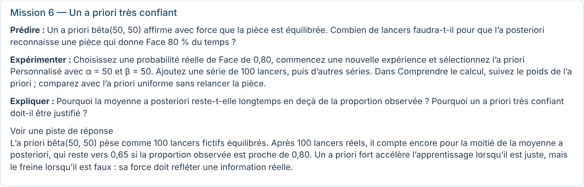
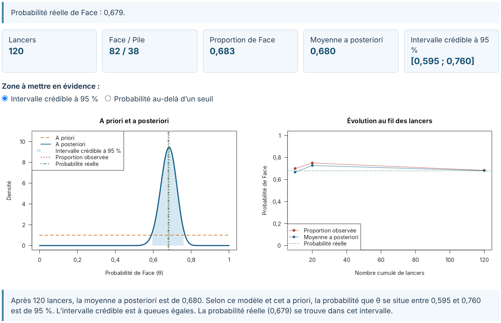

# Six missions guidées {#sec-missions}

```{r}
#| include: false
source("_common.R")
seance <- function(g, mode, th, lots) { e <- experience(g, mode, th); for (l in lots) e$lancer(l); list(th = e$theta(), h = e$etat()$hist) }
intv <- function(v) paste0("[", fmt(v[1]), " ; ", fmt(v[2]), "]")
pct5 <- function(v) ifelse(v > .9995, "> 99,9 %", pct(v))
lots3 <- c(10, 10, rep(100, 5))
m2 <- seance(G, "connue", .30, c(10, 10, 100, 100))
m3a <- seance(G, "connue", .52, lots3); m3b <- seance(G + 1L, "connue", .52, lots3)
m6 <- seance(G, "connue", .80, c(100, 100, 100))
mm <- seance(G, "mystere", .5, c(10, 10, 100))
p5 <- function(h, ab = c(1, 1)) sapply(seq_len(nrow(h)), function(i) { q <- posterieure(ab, h$faces[i], h$n[i]); pbeta(.5, q[1], q[2], lower.tail = FALSE) })
```

::: {.callout-tip title="Objectifs d’apprentissage"}
À la fin de ce chapitre, vous aurez :

1. appliqué la démarche **prédire, expérimenter, expliquer** à six situations ;
2. confronté vos prédictions à des résultats reproductibles (graine 2026) ;
3. constaté la variabilité d’une expérience à l’autre en changeant de graine ;
4. tenu un journal d’expériences suffisant pour qu’une autre personne puisse les refaire.
:::

::: {.callout-important title="Idée centrale"}
Une mission vaut surtout par la **prédiction** formulée avant de cliquer : c’est l’écart entre ce que l’on attendait et ce que l’on observe qui fait apprendre. Les résultats de référence permettent de vérifier une manipulation ; une seconde graine rappelle qu’un autre tirage aurait pu raconter une histoire un peu différente.
:::

Les six missions reprennent celles de l’onglet **Expérimenter** de l’application (@fig-app-mission-6). Pour chacune, formulez une prédiction, effectuez la manipulation, puis confrontez votre explication à la piste de réponse. Les lancers sont aléatoires : sans graine, vos valeurs ne seront pas celles d’une autre personne.

::: {.callout-note title="Reproduire les résultats de référence"}
Chaque mission propose des résultats de référence obtenus avec la graine 2026. Pour les retrouver : cliquez sur **Nouvelle expérience**, réglez la pièce, entrez 2026 dans **Graine (0 = au hasard)**, réglez **Nombre de lancers à ajouter**, puis cliquez sur **Lancer la pièce** en respectant la suite de séries indiquée. Changer d’a priori ne modifie pas les lancers : on peut le faire à tout moment.
:::

{#fig-app-mission-6}

## Mission 1 : l’influence de l’a priori

**Prédire.** Quelles différences attendez-vous entre les quatre a priori après 10 lancers ? Après plusieurs centaines ?

**Expérimenter.** Commencez une nouvelle expérience, ajoutez 10 lancers et examinez **Comparer les a priori**. Notez l’écart entre les moyennes. Ajoutez des séries et observez les distributions et leurs intervalles (chapitre 4).

**Expliquer.** Que devient le poids relatif de l’a priori ? Les distributions deviennent-elles identiques ?

::: {.callout-note collapse="true" title="Piste de réponse"}
Avec peu de données, les conclusions peuvent être sensibles à l’a priori. Pour un a priori fixé, son poids relatif dans la moyenne diminue avec le nombre de lancers. Les distributions tendent à se rapprocher, sans nécessairement devenir identiques.
:::

::: {.callout-tip collapse="true" title="Résultats de référence (graine 2026)"}
Pièce à 0,70 ; séries de 10, 10, 100, 100 et 100 lancers : c’est la séance de référence. L’écart entre les moyennes passe de `r fmt(5/21)` après 10 lancers à `r fmt(5/331)` après 320 (@tbl-ecart). Après 10 lancers, $P(\theta > 0{,}5 \mid D)$ va de 25,2 % à 94,2 % selon l’a priori ; après 120 lancers, elle dépasse 99,9 % pour les quatre (@tbl-sensibilite).
:::

## Mission 2 : quand les observations surprennent

**Prédire.** Que se passe-t-il si l’on favorise Face a priori et que l’on observe surtout Pile ?

**Expérimenter.** Choisissez une probabilité réelle de 0,30, commencez une nouvelle expérience et sélectionnez **Face favorisée**. Ajoutez 10 lancers, puis d’autres séries. Dans **Explorer** et **Comprendre le calcul**, comparez l’a priori, la proportion observée, l’a posteriori et les poids.

**Expliquer.** Dans quelle direction la distribution se déplace-t-elle ? À quelle vitesse ?

::: {.callout-note collapse="true" title="Piste de réponse"}
Si la proportion observée est inférieure à la moyenne a priori, la moyenne a posteriori se déplace vers les petites valeurs. Son déplacement dépend du nombre de lancers et de la force de l’a priori. Les premiers résultats peuvent cependant aller dans l’autre sens : une probabilité de 0,30 ne garantit pas une majorité de Pile dans chaque petite série.
:::

::: {.callout-tip collapse="true" title="Résultats de référence (graine 2026)"}
Pièce à 0,30, a priori **Face favorisée** ; séries de 10, 10, 100 et 100 lancers.

```{r}
h <- m2$h; qs <- lapply(seq_len(nrow(h)), function(i) posterieure(priors[["Face favorisée"]], h$faces[i], h$n[i]))
knitr::kable(data.frame(Lancers = h$n, Face = h$faces, Proportion = fmt(h$faces / h$n),
  `A posteriori` = sapply(qs, beta_txt), Moyenne = sapply(qs, function(q) fmt(moyenne_beta(q))),
  `Intervalle crédible` = sapply(qs, function(q) intv(ic_beta(q))), `Poids de l’a priori` = pct(11 / (11 + h$n)),
  check.names = FALSE), align = "rrrlrcr")
```

Partie de 0,727, la moyenne descend à `r fmt(moyenne_beta(qs[[1]]))` après 10 lancers, puis à `r fmt(moyenne_beta(qs[[4]]))` après 220. Après 10 lancers, l’a priori pèse encore pour plus de la moitié de la moyenne ; après 220, pour moins de 5 %.
:::

## Mission 3 : une pièce presque équilibrée

**Prédire.** Suffit-il de quelques lancers pour conclure que Face est favorisée lorsque la probabilité réelle est 0,52 ?

**Expérimenter.** Choisissez 0,52, une nouvelle expérience et l’a priori uniforme. Ajoutez progressivement des lancers. Examinez l’intervalle crédible, puis choisissez **Probabilité au-delà d’un seuil** et réglez le seuil à 0,5. Recommencez avec une autre graine.

**Expliquer.** Comment ces résultats évoluent-ils ? Pourquoi varient-ils d’une expérience à l’autre ?

::: {.callout-note collapse="true" title="Piste de réponse"}
La différence avec 0,5 est faible ; les fluctuations d’échantillonnage peuvent la masquer ou l’amplifier. L’intervalle crédible se resserre avec davantage de lancers, mais ses bornes et la probabilité que $\theta$ dépasse 0,5 peuvent monter ou descendre au fil des séries. Des expériences différentes peuvent donc conduire temporairement à des conclusions différentes.
:::

::: {.callout-tip collapse="true" title="Résultats de référence (graines 2026 et 2027)"}
Pièce à 0,52, a priori uniforme ; séries de 10, 10, puis cinq de 100 lancers.

```{r}
knitr::kable(data.frame(Lancers = m3a$h$n,
  `Face (2026)` = m3a$h$faces, `Intervalle (2026)` = sapply(seq_len(7), function(i) intv(ic_beta(posterieure(c(1, 1), m3a$h$faces[i], m3a$h$n[i])))),
  `P(θ > 0,5) (2026)` = pct(p5(m3a$h)),
  `Face (2027)` = m3b$h$faces, `P(θ > 0,5) (2027)` = pct(p5(m3b$h)), check.names = FALSE), align = "rrcrrr")
```

Avec la graine 2026, $P(\theta > 0{,}5 \mid D)$ grimpe jusqu’à `r pct(tail(p5(m3a$h), 1))` ; avec la graine 2027, elle commence haut (`r pct(p5(m3b$h)[2])` après 20 lancers), puis **redescend** à `r pct(tail(p5(m3b$h), 1))` après 520 lancers (@fig-mission-3). Même avec 520 lancers, distinguer 0,52 de 0,50 reste difficile : l’intervalle crédible final contient 0,5 dans les deux expériences.
:::

```{r}
#| label: fig-mission-3
#| fig-cap: "Mission 3 : probabilité a posteriori que la pièce favorise Face, au fil des séries, pour deux graines (pièce à 0,52, a priori uniforme)."
#| fig-height: 3
d3 <- rbind(data.frame(n = m3a$h$n, p = p5(m3a$h), g = "Graine 2026"), data.frame(n = m3b$h$n, p = p5(m3b$h), g = "Graine 2027"))
ggplot(d3, aes(n, p, colour = g, shape = g)) + geom_line(linewidth = 1) + geom_point(size = 2.5) +
  geom_hline(yintercept = .5, linetype = "dotted", colour = "grey40") +
  scale_colour_manual(values = c("#125c88", "#a45f00"), name = NULL) + scale_shape_manual(values = c(16, 17), name = NULL) +
  scale_y_continuous(labels = function(v) paste0(fmt_axe(100 * v), " %"), limits = c(0, 1)) +
  labs(x = "Nombre cumulé de lancers", y = "P(θ > 0,5 | D)")
```

## Mission 4 : même centre, force différente

**Prédire.** Les a priori Uniforme et Plutôt équilibrée ont-ils la même influence puisqu’ils ont la même moyenne ?

**Expérimenter.** Choisissez 0,70, commencez une nouvelle expérience et comparez ces deux a priori avant les lancers dans **Comparer les a priori**. Ajoutez 10 lancers, puis d’autres séries. Comparez leurs moyennes et leurs intervalles.

**Expliquer.** Pourquoi deux distributions centrées sur 0,5 peuvent-elles conduire à des conclusions différentes ?

::: {.callout-note collapse="true" title="Piste de réponse"}
Les deux moyennes initiales valent 0,5, mais bêta(8, 8) est plus concentrée et reçoit davantage de poids dans la moyenne a posteriori. Des observations proches de 0,5 peuvent néanmoins donner des moyennes semblables ; les intervalles restent instructifs.
:::

::: {.callout-tip collapse="true" title="Résultats de référence (graine 2026)"}
Séance de référence (pièce à 0,70).

```{r}
sel <- c(1, 2, 5)
lig <- function(nm) sapply(sel, function(i) { q <- posterieure(priors[[nm]], H$faces[i], H$n[i]); paste0(fmt(moyenne_beta(q)), " ", intv(ic_beta(q))) })
knitr::kable(data.frame(Lancers = H$n[sel], Uniforme = lig("Uniforme"), `Plutôt équilibrée` = lig("Plutôt équilibrée"), check.names = FALSE), align = "rcc")
```

Après 10 lancers, Plutôt équilibrée retient la moyenne près de 0,5 et donne un intervalle plus étroit ; après 320 lancers, les deux analyses ne diffèrent plus qu’au deuxième chiffre après la virgule.
:::

## Mission 5 : faire varier le seuil

**Prédire.** Que devient la probabilité a posteriori si le seuil passe de 0,5 à 0,7 ?

**Expérimenter.** Dans **Explorer**, choisissez **Probabilité au-delà d’un seuil** et déplacez le curseur sans changer les lancers ni l’a priori. Essayez aussi les seuils 0 et 1.

**Expliquer.** Pourquoi cette probabilité ne peut-elle pas augmenter lorsque le seuil augmente ?

::: {.callout-note collapse="true" title="Piste de réponse"}
L’ensemble des valeurs supérieures à 0,7 est inclus dans celui des valeurs supérieures à 0,5 ; sa probabilité ne peut donc pas être plus grande. Avec les distributions continues utilisées ici, la probabilité vaut 100 % au seuil 0 et 0 % au seuil 1. L’affichage est arrondi.
:::

::: {.callout-tip collapse="true" title="Résultats de référence (graine 2026)"}
Séance de référence, a priori uniforme. La @fig-mission-5 trace $P(\theta > s \mid D)$ en fonction du seuil $s$ : la courbe ne fait que descendre. Après 10 lancers, elle descend lentement (la distribution est large) ; après 320 lancers, elle chute brusquement autour de 0,69.

```{r}
s <- c(0, .5, .6, .7, .8, 1); q1 <- posterieure(c(1, 1), H$faces[1], H$n[1]); q5 <- posterieure(c(1, 1), H$faces[5], H$n[5])
knitr::kable(data.frame(Seuil = fmt(s, 2), `10 lancers` = pct(pbeta(s, q1[1], q1[2], lower.tail = FALSE)),
  `320 lancers` = ifelse(s == 0, "100,0 %", pct5(pbeta(s, q5[1], q5[2], lower.tail = FALSE))), check.names = FALSE), align = "rrr")
```
:::

```{r}
#| label: fig-mission-5
#| fig-cap: "Mission 5 : probabilité a posteriori au-delà du seuil s, après 10 et après 320 lancers de la séance de référence (a priori uniforme)."
#| fig-height: 3
ss <- seq(0, 1, length.out = 401)
d5 <- rbind(data.frame(s = ss, p = pbeta(ss, q1[1], q1[2], lower.tail = FALSE), e = "10 lancers"),
            data.frame(s = ss, p = pbeta(ss, q5[1], q5[2], lower.tail = FALSE), e = "320 lancers"))
ggplot(d5, aes(s, p, colour = e, linetype = e)) + geom_line(linewidth = 1.1) +
  scale_colour_manual(values = c("#87bdd7", "#125c88"), name = NULL) + scale_linetype_manual(values = c("dashed", "solid"), name = NULL) +
  scale_x_continuous(labels = fmt_axe, breaks = seq(0, 1, .1)) + scale_y_continuous(labels = function(v) paste0(fmt_axe(100 * v), " %")) +
  labs(x = "Seuil s", y = "P(θ > s | D)")
```

## Mission 6 : un a priori très confiant

**Prédire.** Un a priori bêta(50, 50) affirme avec force que la pièce est équilibrée. Après 100 lancers d’une pièce à 0,80, la moyenne a posteriori sera-t-elle plus près de 0,5 ou de la proportion observée ? Quel poids chaque source recevra-t-elle ?

**Expérimenter.** Choisissez une probabilité réelle de Face de **0,80** et l’a priori **Personnalisé**, avec $\alpha = 50$ et $\beta = 50$. Commencez une nouvelle expérience et ajoutez une série de 100 lancers. Notez le nombre de Face, la proportion observée, la moyenne a posteriori et les poids affichés dans **Comprendre le calcul**. Sans refaire les lancers, sélectionnez l’a priori uniforme et comparez. Revenez à bêta(50, 50), ajoutez deux séries de 100 lancers et observez le poids de l’a priori.

**Expliquer.** Pourquoi les conclusions diffèrent-elles après 100 lancers ? Que devient le poids de l’a priori après 300 lancers ? Pourquoi un a priori très confiant doit-il être justifié ?

::: {.callout-note collapse="true" title="Piste de réponse"}
Pour bêta(50, 50), la somme des paramètres vaut 100. Après 100 lancers, les deux poids sont égaux à 50 % : la moyenne a posteriori se trouve exactement à mi-chemin entre 0,5 et la proportion observée. Si l’on a obtenu exactement 80 Face, elle vaut 0,65 ; le résultat varie toutefois selon les lancers. Après 300 lancers, le poids de l’a priori est $100/(100 + 300) = 25\,\%$. L’a priori uniforme pèse beaucoup moins pour les mêmes données, car la somme de ses paramètres vaut 2. Un a priori fort accélère l’apprentissage lorsqu’il est juste et le freine lorsqu’il est faux : sa force doit refléter une information réelle.
:::

::: {.callout-tip collapse="true" title="Résultats de référence (graine 2026)"}
Pièce à 0,80 ; trois séries de 100 lancers.

```{r}
h <- m6$h
lig6 <- function(ab) sapply(seq_len(nrow(h)), function(i) { q <- posterieure(ab, h$faces[i], h$n[i]); paste0(fmt(moyenne_beta(q)), " ", intv(ic_beta(q))) })
knitr::kable(data.frame(Lancers = h$n, Face = h$faces, Proportion = fmt(h$faces / h$n), `Poids de bêta(50, 50)` = pct(100 / (100 + h$n)),
  `bêta(50, 50)` = lig6(c(50, 50)), Uniforme = lig6(c(1, 1)), check.names = FALSE), align = "rrrrcc")
```

Après 100 lancers, la moyenne bêta(50, 50) vaut $(50 + `r h$faces[1]`)/200 = `r nbm((50 + h$faces[1]) / 200)`$, à mi-chemin entre 0,5 et `r fmt(h$faces[1] / 100)`. Après 300 lancers, son intervalle **exclut encore 0,80**, alors que l’intervalle uniforme le contient.
:::

## Défi : la pièce mystère

**Prédire.** Combien de lancers vous faudra-t-il pour situer une pièce mystère à 0,1 près ?

**Expérimenter.** Choisissez **Pièce mystère**, l’a priori uniforme et la graine 2026. Lancez 10, puis 10, puis 100 fois. Notez l’intervalle crédible à chaque étape. Ne révélez la pièce qu’à la fin, avec **Révéler la probabilité réelle** (@fig-app-mystere-revelee).

**Expliquer.** La probabilité réelle est-elle dans votre dernier intervalle ? Ce résultat confirme-t-il que l’intervalle « était juste » ?

::: {.callout-tip collapse="true" title="Résultats de référence (graine 2026)"}
```{r}
h <- mm$h; qm <- lapply(seq_len(nrow(h)), function(i) posterieure(c(1, 1), h$faces[i], h$n[i]))
knitr::kable(data.frame(Lancers = h$n, Face = h$faces, Moyenne = sapply(qm, function(q) fmt(moyenne_beta(q))),
  `Intervalle crédible` = sapply(qm, function(q) intv(ic_beta(q))), Largeur = sapply(qm, function(q) fmt(diff(ic_beta(q)))),
  check.names = FALSE), align = "rrrcr")
```

La pièce révélée vaut `r fmt(mm$th)`, dans l’intervalle final. Après 120 lancers, la demi-largeur de l’intervalle est passée sous 0,1. Que la valeur soit dans l’intervalle ne « prouve » rien à elle seule : dans environ 5 % des expériences de ce genre, elle n’y serait pas (chapitre 3).
:::

{#fig-app-mystere-revelee}

## Garder une trace de ses expériences

Une réponse utile décrit les réglages et les observations avant de proposer une interprétation. Pour chaque mission, notez :

- la probabilité réelle choisie ou le mode **Pièce mystère** ;
- l’a priori et, s’il est personnalisé, les valeurs de $\alpha$ et $\beta$ ;
- la graine affichée et la suite des tailles de séries ;
- les nombres cumulés de lancers et de Face ;
- les résultats pertinents : moyenne, intervalle, poids ou probabilité au-delà du seuil ;
- votre prédiction initiale et ce que les résultats vous conduisent à revoir.

La valeur 0 pour la graine demande une graine choisie au hasard ; la graine ensuite affichée peut être notée pour reprendre l’expérience, avec les mêmes réglages et la même suite de clics. Une graine sert à **reproduire un exemple**, pas à prouver qu’un résultat est typique : refaites aussi l’exercice avec d’autres graines pour examiner la variabilité, comme dans la mission 3.

| Mission | Avant de manipuler | Pendant l’expérience | Pour interpréter |
|:--|:--|:--|:--|
| 1. Influence de l’a priori | Prédire les différences entre les quatre points de départ. | Noter les moyennes, leur écart et les intervalles après 10 puis plusieurs centaines de lancers. | Distinguer le rapprochement des moyennes de l’égalité des distributions. |
| 2. Données surprenantes | Prédire la réaction d’un a priori favorisant Face si les données favorisent Pile. | Suivre la proportion observée, la moyenne a priori et la moyenne a posteriori. | Expliquer le compromis et tenir compte des fluctuations des premières séries. |
| 3. Pièce presque équilibrée | Anticiper la difficulté de distinguer 0,52 de 0,50. | Noter l’intervalle crédible et $P(\theta > 0{,}5 \mid D)$ au fil des lancers, pour deux graines. | Ne pas supposer que chaque nouvelle série renforce la même conclusion. |
| 4. Même centre, force différente | Prédire l’effet de deux a priori centrés sur 0,5. | Comparer les courbes et les intervalles d’Uniforme et de Plutôt équilibrée avec les mêmes lancers. | Expliquer pourquoi la moyenne seule ne décrit pas toute une distribution. |
| 5. Faire varier le seuil | Prédire l’effet d’une augmentation du seuil. | Garder les données fixes et noter les aires pour plusieurs seuils, dont 0 et 1. | Relier la diminution de l’aire à l’inclusion des ensembles de valeurs. |
| 6. A priori très confiant | Prédire le poids de bêta(50, 50) après 100 lancers. | Noter les poids, les moyennes et les intervalles, avec bêta(50, 50) puis l’a priori uniforme. | Relier la force de l’a priori à sa justification. |

: Grille d’observation des six missions {#tbl-grille}

## Petit bilan personnel

Après ces activités, rédigez quelques phrases répondant aux questions suivantes :

1. Quelle différence faites-vous entre une proportion observée et une probabilité de Face inconnue ?
2. Que peut révéler une comparaison de plusieurs a priori avec les mêmes données ?
3. En quoi la probabilité d’un prochain Face diffère-t-elle de la probabilité que $\theta$ dépasse un seuil ?
4. Pourquoi la graine rend-elle une expérience reproductible sans rendre ses résultats universels ?

::: {.callout-note collapse="true" title="Éléments de réponse"}
1. La proportion décrit les lancers observés ; $\theta$ décrit la probabilité de Face du modèle.
2. La sensibilité des conclusions au point de départ.
3. La prévision du prochain Face porte sur un résultat futur ; la probabilité au-delà d’un seuil porte sur le paramètre.
4. Reproduire une simulation revient à retrouver une série particulière de résultats : une autre graine peut produire une autre série, comme le montrent les graines 2026 et 2027 de la mission 3.
:::

::: {.callout-important title="À retenir"}
1. Prédire avant de manipuler : c’est la confrontation qui fait apprendre.
2. Les résultats d’une seule expérience ne sont pas universels ; changez de graine pour voir la variabilité.
3. Un a priori pèse d’autant plus qu’il est concentré, et d’autant moins que les lancers s’accumulent.
4. Une petite différence (0,52 contre 0,50) demande beaucoup de lancers pour être établie.
5. Un journal d’expérience complet (pièce, a priori, graine, séries) permet à quiconque de refaire vos observations.
:::

## Quiz

1. Pour retrouver exactement les résultats de référence, il faut :
   a) la même graine seulement ; b) la même graine, les mêmes réglages et la même suite de séries ; c) le même a priori seulement.
2. Changer d’a priori après les lancers :
   a) modifie les lancers ; b) ne modifie pas les lancers ; c) efface l’expérience.
3. Dans la mission 3, $P(\theta > 0{,}5 \mid D)$ :
   a) augmente toujours avec le nombre de lancers ; b) peut monter puis redescendre ; c) vaut toujours 52 %.
4. Après 300 lancers, le poids de bêta(50, 50) dans la moyenne a posteriori vaut :
   a) 50 % ; b) 25 % ; c) 1/3.
5. Une pièce mystère révélée à l’intérieur de l’intervalle crédible prouve que :
   a) l’a priori était le bon ; b) le calcul est exact ; c) rien à elle seule : c’est le résultat d’une expérience.

::: {.callout-tip collapse="true" title="Réponses du quiz"}
1. **b.**
2. **b.**
3. **b.**
4. **b.**
5. **c.**
:::
