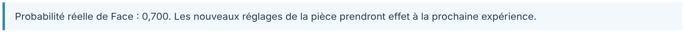

# Ce que l’expérience nous apprend et ses limites {#sec-limites}

```{r}
#| include: false
source("_common.R")
intv <- function(v) paste0("[", fmt(v[1]), " ; ", fmt(v[2]), "]")
# Pièce qui change à mi-parcours (simulation hors application)
set.seed(G); xch <- c(rbinom(160, 1, .3), rbinom(160, 1, .8)); fch <- sum(xch); qch <- c(1 + fch, 1 + 320 - fch)
f1 <- sum(xch[1:160]); f2 <- sum(xch[161:320])
# Lancers dépendants : chaîne de Markov qui répète le résultat précédent avec une probabilité donnée
markov <- function(n, rester) { v <- numeric(n); v[1] <- rbinom(1, 1, .5); for (i in 2:n) v[i] <- if (runif(1) < rester) v[i - 1] else 1 - v[i - 1]; v }
set.seed(G)
couvd <- sapply(c(.5, .7, .8, .9), function(r) mean(replicate(4000, { v <- markov(100, r); k <- sum(v); ci <- qbeta(c(.025, .975), 1 + k, 101 - k); ci[1] <= .5 & .5 <= ci[2] })))
# Dix pièces mystères (graines 1 à 10, deux séries de 10 lancers)
mys <- do.call(rbind, lapply(1:10, function(g) { e <- experience(g, "mystere"); e$lancer(10); e$lancer(10); s <- e$etat()
  ci <- ic_beta(c(1 + s$faces, 21 - s$faces)); data.frame(g = g, th = e$theta(), f = s$faces, i1 = ci[1], i2 = ci[2], dedans = e$theta() >= ci[1] & e$theta() <= ci[2]) }))
# A priori tronqué sur [0,4 ; 0,6] avec les 320 lancers de référence
dpo <- function(t) dbeta(t, 1 + H$faces[5], 1 + H$n[5] - H$faces[5])
mtr <- integrate(function(t) t * dpo(t), .4, .6)$value / integrate(dpo, .4, .6)$value
```

::: {.callout-tip title="Objectifs d’apprentissage"}
À la fin de ce chapitre, vous pourrez :

1. énoncer les hypothèses du modèle bêta-binomial et dire ce qui se passe lorsqu’elles sont violées ;
2. distinguer l’indépendance des lancers **sachant $\theta$** de la dépendance des prévisions lorsque $\theta$ est inconnue ;
3. expliquer pourquoi un intervalle étroit peut être trompeur dans un modèle inadéquat ;
4. reconnaître ce qu’une simulation permet de vérifier, et ce qu’elle ne permet pas ;
5. formuler une conclusion bayésienne en précisant ses conditions.
:::

::: {.callout-important title="Idée centrale"}
Une conclusion bayésienne est **conditionnelle** : elle vaut pour le modèle, l’a priori et les données retenus. Accumuler des lancers réduit l’influence de l’a priori, mais ne corrige pas un modèle inadéquat : si la pièce change ou si les lancers dépendent les uns des autres, l’a posteriori peut être à la fois très précis et faux.
:::

Les données modifient les connaissances exprimées par l’a priori. Avec peu de lancers, le choix de l’a priori peut compter beaucoup ; avec davantage de données, son influence relative diminue. Une distribution a posteriori exprime toujours une incertitude et dépend du modèle retenu.

## Des conclusions conditionnelles au modèle

Une conclusion bayésienne n’est pas produite par les données seules. Elle repose sur trois ingrédients : un **a priori**, un **modèle** qui relie $\theta$ aux résultats possibles, et les **observations** effectivement recueillies. Dire « selon le modèle et l’a priori retenus » précise donc les conditions dans lesquelles l’interprétation est valable.

Dans l’application, le modèle suppose que :

1. chaque lancer donne Face ou Pile ;
2. les lancers sont **indépendants** sachant $\theta$ ;
3. la même probabilité $\theta$ s’applique à **chaque lancer** de l’expérience ;
4. les résultats sont **correctement observés et tous retenus**.

Ces hypothèses rendent possible la mise à jour bêta-binomiale du chapitre 2. Dans l’application, elles sont vraies par construction. Ce sont elles qu’il faut examiner lorsqu’on transpose le raisonnement à une situation réelle.

## L’indépendance : qu’affirme-t-on ?

Dans le modèle, connaître les résultats précédents ne modifie pas la probabilité du prochain Face **si l’on connaît $\theta$**. Pour une pièce ayant $\theta = 0{,}5$, une série de cinq Pile ne rend donc pas Face « dû » au sixième lancer : sa probabilité demeure 0,5. Croire le contraire est l’**erreur du joueur**.

Lorsque $\theta$ est inconnue, les observations modifient cependant notre connaissance de cette probabilité. Avec l’a priori uniforme, après cinq Pile, la probabilité *prédictive* du prochain Face devient $(0 + 1)/(5 + 2) = 1/7 \approx `r nbm(1/7)`$ (règle de Laplace) : cinq Pile rendent **moins** probable un Face, non plus probable, parce qu’ils suggèrent une pièce qui favorise Pile. Il n’y a pas de contradiction : les lancers sont indépendants **conditionnellement à $\theta$**, tandis que l’incertitude sur $\theta$ relie leurs prévisions.

### Quand les lancers dépendent les uns des autres

Supposons une pièce équilibrée mais lancée de façon telle que chaque résultat tend à répéter le précédent. On peut le simuler en dehors de l’application : à chaque lancer, le résultat précédent est répété avec une probabilité $r$. Le modèle de l’application, qui suppose $r = 0{,}5$, est alors faux. Le @tbl-dependance donne, sur 4 000 expériences simulées de 100 lancers, la proportion d’intervalles crédibles (a priori uniforme) qui contiennent la vraie valeur 0,5.

```{r}
#| label: tbl-dependance
#| tbl-cap: "Proportion d’intervalles crédibles à 95 % contenant θ = 0,5 lorsque les lancers sont dépendants (4 000 expériences de 100 lancers par ligne)."
knitr::kable(data.frame(`Probabilité de répéter le résultat précédent` = c("0,5 (indépendance)", "0,7", "0,8", "0,9"),
  `Intervalles contenant 0,5` = pct(couvd), check.names = FALSE), align = "lr")
```

Avec des lancers indépendants, on retrouve environ 95 %. Plus la dépendance est forte, plus les intervalles sont **trop étroits** : 100 lancers dépendants contiennent moins d’information que 100 lancers indépendants, mais le modèle les compte comme s’ils étaient indépendants.

## Une probabilité stable pendant l’expérience

Le modèle traite $\theta$ comme constante. Si la pièce ou les conditions de lancer changent en cours d’expérience, un seul paramètre représente mal l’ensemble. L’application en tient compte : si l’on déplace **Probabilité réelle de Face** après le premier lancer, elle avertit que les nouveaux réglages ne prendront effet qu’à la prochaine expérience (@fig-app-piece-changee).

{#fig-app-piece-changee}

Que se passerait-il si la pièce changeait vraiment ? Simulons, hors de l’application, 160 lancers d’une pièce à 0,30 suivis de 160 lancers d’une pièce à 0,80 (graine 2026). On obtient `r f1` puis `r f2` Face, soit `r fch` Face sur 320. Analysés comme une seule pièce avec l’a priori uniforme, ces lancers donnent `r beta_txt(qch)`, de moyenne `r fmt(moyenne_beta(qch))` et d’intervalle crédible `r intv(ic_beta(qch))` (@fig-piece-changee).

```{r}
#| label: fig-piece-changee
#| fig-cap: "Une pièce qui change en cours d’expérience (0,30 puis 0,80), analysée comme une seule pièce : l’a posteriori est étroit et centré sur une valeur qu’aucune des deux pièces n’a jamais eue."
#| fig-height: 3
x <- seq(0, 1, length.out = 801)
ggplot(data.frame(x = x, y = dbeta(x, qch[1], qch[2])), aes(x, y)) + geom_line(colour = "#125c88", linewidth = 1.1) +
  geom_vline(xintercept = c(.3, .8), linetype = "dashed", colour = "#a12626") +
  annotate("text", x = c(.3, .8), y = max(dbeta(x, qch[1], qch[2])) * .9, label = c("Pièce 1 : 0,30", "Pièce 2 : 0,80"),
           hjust = c(1.05, -0.05), colour = "#a12626", size = 3.5) +
  scale_x_continuous(labels = fmt_axe, breaks = seq(0, 1, .1)) + scale_y_continuous(labels = fmt_axe) + labs(x = "θ", y = "Densité")
```

L’intervalle est étroit, mais il ne contient ni 0,30 ni 0,80 : il reflète une grande précision **à l’intérieur d’un modèle inadéquat**. Un examen simple aurait pourtant alerté : la proportion de Face vaut `r fmt(f1/160)` dans la première moitié et `r fmt(f2/160)` dans la seconde. De même, si l’enregistrement des résultats comporte des erreurs ou si des lancers sont sélectionnés, les données analysées ne correspondent plus au modèle supposé. Il faut donc examiner le mécanisme de collecte autant que les résultats numériques.

## Quand l’a priori compte beaucoup

Les a priori prédéfinis de l’application perdent progressivement leur poids relatif à mesure que le nombre de lancers augmente. Mais une distribution très concentrée, comme bêta(50, 50), peut encore influencer fortement les conclusions après plusieurs centaines d’observations : la mission 6 montre que son intervalle exclut encore 0,80 après 300 lancers d’une pièce à 0,80.

La comparaison entre a priori raisonnables aide à évaluer cette sensibilité (chapitre 4). Si une conclusion dépend fortement d’un choix initial, il est plus informatif de présenter cette dépendance que de retenir uniquement le résultat préféré.

::: {.callout-note title="Une restriction à garder en tête"}
Si un a priori excluait complètement certaines valeurs de $\theta$, aucune observation ne pourrait leur redonner une probabilité a posteriori positive : l’a posteriori est proportionnel à l’a priori, et zéro fois n’importe quoi reste zéro. Supposons par exemple un a priori uniforme **sur [0,4 ; 0,6] seulement**. Avec les 320 lancers de la séance de référence (`r H$faces[5]` Face, proportion `r fmt(H$faces[5] / H$n[5])`), l’a posteriori s’entasse contre la borne 0,6, avec une moyenne de `r fmt(mtr)` : il ne peut pas atteindre 0,70. Les lois bêta utilisées dans l’application attribuent une densité positive à toutes les valeurs entre 0 et 1 ; elles ne rendent donc impossible aucune valeur intérieure.
:::

## Ce qu’on peut — et ne peut pas — vérifier dans la simulation

La pièce mystère donne l’occasion de comparer les résultats à une valeur générée, puis révélée. Si cette valeur est dans l’intervalle crédible, on sait que **cet intervalle précis** la contient ; si elle est à l’extérieur, on sait qu’il ne la contient pas. Un seul essai ne mesure pas la qualité générale d’une procédure.

Pour étudier une couverture, il faut répéter un grand nombre d’expériences dans des conditions clairement définies et calculer la proportion d’intervalles qui contiennent la valeur réelle (chapitre 3). Cette question est différente de l’affirmation selon laquelle un intervalle crédible contient 95 % de la distribution a posteriori pour les données observées. En classe, on peut toutefois approcher l’idée en mettant en commun les résultats de plusieurs personnes (voir l’atelier).

## Des simulations reproductibles, mais variables

La graine aide à rejouer une expérience : conservez la graine affichée, les réglages et la suite des tailles de séries. Une expérience reproduite montre **le même exemple** ; plusieurs graines permettent d’observer que des séries différentes peuvent donner des conclusions différentes, même lorsque la probabilité réelle de la pièce reste la même (mission 3).

::: {.callout-note title="🖥️ Dans l’application"}
- Les hypothèses du modèle sont vraies **par construction** : lancers indépendants, $\theta$ fixée au premier lancer et gardée pour toute l’expérience. Modifier la pièce en cours de route n’a d’effet qu’après **Nouvelle expérience**.
- Les situations où le modèle est faux (pièce qui change, lancers dépendants, a priori tronqué) ne se simulent pas dans l’application ; elles sont illustrées dans ce chapitre par des simulations faites à part.
- **Pièce mystère** et **Révéler la probabilité réelle** permettent de confronter une conclusion à la valeur cachée, une expérience à la fois.
:::

## Atelier guidé dans l’application {#sec-atelier-6}

1. Lancez une expérience avec **Probabilité connue** à 0,70 et 10 lancers. Déplacez ensuite **Probabilité réelle de Face** à 0,30. Que dit l’application ? Pourquoi refuse-t-elle de changer la pièce ?
2. **Activité de groupe.** Chaque personne choisit une graine différente entre 1 et 10, sélectionne **Pièce mystère** et l’a priori uniforme, puis lance deux séries de 10 lancers. Elle note l’intervalle crédible, révèle la pièce et indique si la valeur réelle est dans l’intervalle.
3. Mettez les résultats en commun. Quelle proportion d’intervalles contient la valeur réelle ? Que faudrait-il pour que cette proportion soit une estimation fiable de la couverture ?

::: {.callout-tip collapse="true" title="Résultats de référence"}
**Étape 1.** « Les nouveaux réglages de la pièce prendront effet à la prochaine expérience. » Le modèle exige une seule $\theta$ par expérience ; changer la pièce en cours de route rendrait l’analyse invalide.

**Étapes 2 et 3.**

```{r}
knitr::kable(data.frame(Graine = mys$g, `Pièce révélée` = fmt(mys$th), `Face / 20` = mys$f,
  `Intervalle crédible` = mapply(function(a, b) intv(c(a, b)), mys$i1, mys$i2), `Contient la pièce ?` = ifelse(mys$dedans, "oui", "non"),
  check.names = FALSE), align = "rrrcc")
```

`r sum(mys$dedans)` intervalles sur 10 contiennent la pièce. Les graines `r paste(mys$g[!mys$dedans], collapse = " et ")` donnent des intervalles qui la manquent : ce sont des expériences ordinaires, pas des erreurs de calcul. Avec 10 expériences seulement, la proportion observée est très imprécise ; il en faudrait des centaines pour estimer une couverture voisine de 95 %.
:::

## Exercices

**Exercice 1.** Une pièce équilibrée vient de donner cinq Pile de suite. Quelle est la probabilité du prochain Face si l’on sait que $\theta = 0{,}5$ ? Si $\theta$ est inconnue et que l’on part de l’a priori uniforme ?

**Exercice 2.** Pourquoi des lancers dépendants rendent-ils les intervalles crédibles trop étroits ?

**Exercice 3.** Une personne lance une pièce 200 fois, mais ne note que les séries « intéressantes ». Quelle hypothèse du modèle est violée ?

**Exercice 4.** Un a priori attribue une densité nulle à toutes les valeurs de $\theta$ supérieures à 0,6. Après 1 000 lancers donnant 800 Face, quelle valeur l’a posteriori peut-il atteindre au maximum ?

**Exercice 5.** Formulez une conclusion complète, avec ses conditions, pour la séance de référence après 320 lancers (a priori uniforme).

::: {.callout-note collapse="true" title="Éléments de correction"}
1. 0,5 si $\theta$ est connue ; $1/7 \approx `r nbm(1/7)`$ si $\theta$ est inconnue, car les cinq Pile rendent plus plausibles les pièces qui favorisent Pile.
2. Le modèle compte chaque lancer comme une information nouvelle et indépendante. Si les lancers se répètent, chacun apporte moins d’information : la distribution a posteriori est plus concentrée qu’elle ne devrait l’être.
3. L’hypothèse que les résultats sont tous retenus : la sélection rend les données non représentatives du mécanisme supposé.
4. 0,6 : aucune valeur au-delà ne peut recevoir de densité positive, quelles que soient les données.
5. Par exemple : « Selon un modèle de lancers indépendants de probabilité constante, avec un a priori uniforme et 222 Face en 320 lancers, la probabilité a posteriori que la probabilité de Face soit comprise entre 0,641 et 0,742 est de 95 %. La conclusion que la pièce favorise Face ne dépend pas des quatre a priori examinés. »
:::

::: {.callout-tip title="Questions à se poser avant de conclure"}
1. Quelles hypothèses rendent le modèle pertinent ? Les lancers sont-ils indépendants et la probabilité stable ?
2. Les données ont-elles toutes été retenues et correctement enregistrées ?
3. Combien d’observations avons-nous ?
4. Les conclusions changent-elles avec des a priori raisonnables ?
5. Quelle incertitude reste-t-il ?
6. L’énoncé concerne-t-il la valeur de $\theta$ ou un prochain lancer ?
:::

::: {.callout-important title="À retenir"}
1. Une conclusion bayésienne est conditionnelle au modèle, à l’a priori et aux données.
2. Les lancers sont indépendants **sachant $\theta$** ; lorsque $\theta$ est inconnue, les observations passées changent les prévisions.
3. Plus de données réduisent l’influence de l’a priori, mais ne corrigent pas un modèle faux.
4. Un intervalle étroit peut être trompeur si le modèle est inadéquat.
5. Un a priori qui exclut une valeur l’exclut pour toujours.
6. Une expérience ne mesure pas la qualité d’une procédure ; il faut en répéter beaucoup.
:::

## Quiz

1. Après cinq Pile avec une pièce **connue** équilibrée, la probabilité du prochain Face vaut :
   a) plus de 0,5 ; b) 0,5 ; c) moins de 0,5.
2. Des lancers qui tendent à répéter le résultat précédent produisent des intervalles crédibles :
   a) trop larges ; b) trop étroits ; c) exacts.
3. Une pièce qui change de 0,30 à 0,80 à mi-parcours, analysée comme une seule pièce, donne un a posteriori :
   a) centré sur 0,30 ; b) centré sur 0,80 ; c) centré entre les deux, sur une valeur qu’aucune pièce n’a eue.
4. Si l’a priori vaut zéro au-delà de 0,6, l’a posteriori au-delà de 0,6 :
   a) reste nul ; b) devient positif avec assez de données ; c) dépend de la graine.
5. Une pièce mystère hors de l’intervalle crédible signifie :
   a) que le calcul est faux ; b) que l’a priori est faux ; c) que cet intervalle précis ne contient pas la valeur, ce qui arrive dans une fraction des expériences.

::: {.callout-tip collapse="true" title="Réponses du quiz"}
1. **b.**
2. **b.**
3. **c.**
4. **a.**
5. **c.**
:::
