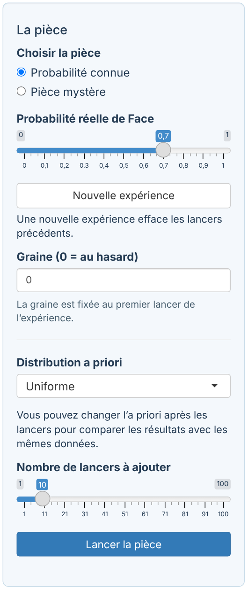
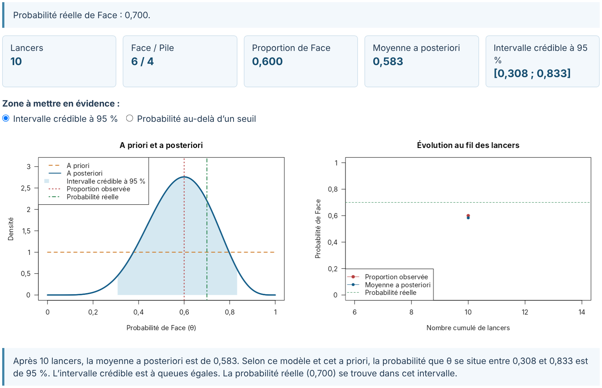

# Introduction {.unnumbered}

```{r}
#| include: false
source("_common.R")
u7 <- posterieure(priors[["Uniforme"]], 7, 10)
q1 <- posterieure(priors[["Uniforme"]], H$faces[1], H$n[1])
```

::: {.content-visible when-format="html"}
```{=html}

```
:::

Une pièce tombe sur Face 7 fois en 10 lancers. Que peut-on en conclure sur sa tendance à produire Face ? Dix lancers renseignent sur la pièce, mais une autre série pourrait donner un résultat différent. L’inférence bayésienne combine les observations avec une description de ce qui était plausible avant de les voir.

Ce manuel accompagne l’application [**BayesCoins**](https://shiny.dcstats.org/BayesCoins) (« Bayes et la pièce de monnaie »). Son objectif est de rendre visibles la mise à jour des connaissances, le rôle de l’a priori et l’incertitude qui demeure après les observations. Il peut être lu de manière autonome ; les activités invitent toutefois à manipuler l’application.

::: {.content-visible when-format="html"}
```{=html}
<div style="clear: both;"></div>
```
:::

## Objectifs

À la fin du parcours, vous pourrez :

- distinguer la probabilité de Face, la proportion observée et une distribution de valeurs plausibles ;
- décrire les rôles de l’a priori, de la vraisemblance et de l’a posteriori ;
- interpréter un intervalle crédible et une probabilité au-delà d’un seuil ;
- comparer les conclusions obtenues avec plusieurs a priori pour les mêmes lancers ;
- reconnaître les hypothèses et les limites du modèle.

## Une probabilité inconnue

Nous notons $\theta$ la probabilité de Face à chaque lancer. Si $\theta = 0{,}70$, la pièce produit Face avec une probabilité de 70 % à chaque lancer. Cela ne signifie pas que chaque série de 10 lancers contiendra exactement 7 Face.

Le modèle suppose des lancers indépendants et une probabilité $\theta$ constante. Dans l’application, on peut fixer cette probabilité pour une simulation ou choisir une **pièce mystère**. Pour celle-ci, l’application tire une valeur au hasard entre 0,05 et 0,95 au premier lancer de l’expérience, puis la garde fixe. Le bouton **Révéler la probabilité réelle** permet ensuite de comparer les conclusions à la valeur utilisée dans la simulation.

## Une question, trois quantités à distinguer

Imaginez une pièce dont nous ne connaissons pas la tendance. Nous effectuons 10 lancers et observons 7 Face. Trois nombres interviennent dans cette situation :

1. **La probabilité de Face $\theta$** est une caractéristique de la pièce dans le modèle. Elle est fixe pendant l’expérience, mais inconnue de la personne qui analyse les données.
2. **La proportion observée**, ici $7/10 = 0{,}70$, résume les lancers effectués. Une autre série de 10 lancers pourrait produire une proportion différente.
3. **La moyenne a posteriori** résume la distribution des valeurs de $\theta$ après avoir combiné les observations et l’a priori. Elle dépend des deux.

Avec l’a priori uniforme de l’application, ces 7 Face et 3 Pile conduisent à une distribution a posteriori `r beta_txt(u7)`, de moyenne $8/12 \approx `r nbm(moyenne_beta(u7))`$. Ce nombre ne remplace pas la proportion observée : les deux répondent à des questions différentes. La proportion décrit la série ; la moyenne a posteriori résume ce que le modèle et l’a priori conduisent à retenir sur $\theta$ après cette série.

::: {.callout-note title="La valeur réelle et ce que l’on sait"}
Dans l’application, on peut connaître ou révéler la valeur utilisée pour simuler les lancers. Dans la plupart des situations réelles, cette valeur n’est pas accessible. La simulation offre donc une occasion particulière : comparer nos conclusions à une valeur de référence.
:::

## L’application en bref

Le panneau de gauche contient les commandes ; les cinq onglets de droite guident l’exploration.

| Commande ou onglet | Rôle |
|:--|:--|
| **Choisir la pièce** | **Probabilité connue** (réglée avec **Probabilité réelle de Face**) ou **Pièce mystère**. |
| **Nouvelle expérience** | Efface les lancers ; la pièce sera fixée au premier lancer suivant. |
| **Graine (0 = au hasard)** | Rend une expérience reproductible (voir plus bas). |
| **Distribution a priori** | Quatre a priori prédéfinis ou **Personnalisé** (α et β au choix). On peut en changer après les lancers. |
| **Nombre de lancers à ajouter**, **Lancer la pièce** | Ajoutent une série de 1 à 100 lancers à l’expérience. |
| **Révéler la probabilité réelle** | Dévoile la probabilité d’une pièce mystère. |
| **Introduction** | Présentation et première expérience à mener. |
| **Explorer** | A priori, a posteriori, intervalle crédible ou probabilité au-delà d’un seuil, évolution au fil des séries. |
| **Comparer les a priori** | Les mêmes lancers analysés avec les quatre a priori prédéfinis. |
| **Comprendre le calcul** | La mise à jour pas à pas, avec vos propres lancers. |
| **Expérimenter** | Six missions « prédire, expérimenter, expliquer ». |

: Commandes et onglets de l’application {#tbl-app-bref}

{#fig-app-panneau width="35%"}

## Reproduire les exemples : la graine 2026

Les lancers sont aléatoires : deux personnes qui font la même manipulation n’obtiennent pas les mêmes résultats. Pour que les exemples du manuel soient reproductibles, entrez une graine dans **Graine (0 = au hasard)** avant le premier lancer d’une expérience. La graine fixe alors la pièce mystère et toute la suite des lancers, **à condition de refaire les mêmes clics dans le même ordre**. La graine utilisée est affichée sous le champ.

Les exemples du manuel utilisent la séance suivante :

1. choisir **Probabilité connue** et laisser **Probabilité réelle de Face** à 0,70 ;
2. entrer 2026 dans **Graine (0 = au hasard)** et laisser l’a priori **Uniforme** ;
3. cliquer sur **Lancer la pièce** avec 10 lancers, deux fois, puis trois fois avec 100 lancers.

Les 10 premiers lancers donnent `r H$faces[1]` Face et `r H$n[1] - H$faces[1]` Pile ; avec l’a priori uniforme, la moyenne a posteriori vaut alors `r nb(moyenne_beta(q1))` (@fig-app-explorer-10). Au terme de la séance, `r H$n[5]` lancers ont donné `r H$faces[5]` Face. Les encadrés **Résultats de référence**, repliés, donnent les valeurs que vous devez retrouver.

{#fig-app-explorer-10}

Le graphique d’évolution, à droite, rapporte les résultats cumulés au moment où chaque série a été ajoutée : une série de 100 lancers produit un seul point supplémentaire.

## Une première exploration pas à pas

1. Choisissez **Probabilité connue** et réglez **Probabilité réelle de Face** à 0,70. Entrez 2026 dans **Graine (0 = au hasard)** ; cliquez sur **Nouvelle expérience** si une expérience est déjà en cours.
2. Laissez l’a priori **Uniforme**, demandez 10 lancers et cliquez sur **Lancer la pièce**.
3. Dans **Explorer**, notez le nombre de Face et la proportion observée. Sont-ils nécessairement égaux à 7 et à 0,70 ?
4. Comparez la courbe a priori, la courbe a posteriori et la ligne de la probabilité réelle. Repérez l’intervalle crédible.
5. Ajoutez 10 lancers, puis trois séries de 100. Observez comment les résultats changent.

::: {.callout-tip collapse="true" title="Résultats de référence (graine 2026)"}
```{r}
qq <- lapply(seq_len(nrow(H)), function(i) posterieure(priors[["Uniforme"]], H$faces[i], H$n[i]))
knitr::kable(data.frame(Lancers = H$n, `Face / Pile` = paste(H$faces, "/", H$n - H$faces),
  `Proportion de Face` = fmt(H$faces / H$n), `Moyenne a posteriori` = sapply(qq, function(q) fmt(moyenne_beta(q))),
  `Intervalle crédible à 95 %` = sapply(qq, function(q) { ci <- ic_beta(q); paste0("[", fmt(ci[1]), " ; ", fmt(ci[2]), "]") }),
  check.names = FALSE), align = "rrrrr")
```

La première série ne donne pas 7 Face mais `r H$faces[1]` : une probabilité de 0,70 ne garantit pas 7 Face en 10 lancers. Au fil des séries, la proportion et la moyenne a posteriori se rapprochent de 0,70 et l’intervalle crédible se resserre ; il contient la probabilité réelle à chaque étape de cette séance.
:::

## Comment utiliser ce manuel

Lisez d’abord les chapitres sur l’a priori et la mise à jour. Revenez ensuite à l’application pour observer les distributions et comparer les a priori. Les missions proposent une démarche **prédire, expérimenter, expliquer** ; les pistes de réponse servent à réfléchir aux mécanismes, non à imposer une valeur numérique que le hasard ne garantit pas. Les exercices permettent enfin de vérifier les distinctions essentielles. L’annexe est facultative lors d’une première lecture.

Chaque chapitre comporte des objectifs, une idée centrale, des figures calculées avec le moteur de l’application, des encadrés **🖥️ Dans l’application**, un atelier guidé suivi de ses résultats de référence, des exercices et un court quiz. Les nombres décimaux s’écrivent avec une virgule, y compris dans les figures.

::: {.callout-tip title="Avant de poursuivre"}
Pourquoi pourrait-on observer 4 Face en 10 lancers même si la probabilité réelle est 0,70 ? Une probabilité décrit le mécanisme de chaque lancer, pas une obligation pour un petit groupe de lancers. Avec $\theta = 0{,}70$, une série de 10 lancers donne 4 Face ou moins dans `r pct(pbinom(4, 10, .7))` des cas. Ce sont ces fluctuations d’échantillonnage qui rendent nécessaire une appréciation de l’incertitude.
:::

## Quelques repères de lecture

Ce manuel présente un modèle d’initiation. Pour une introduction plus large à l’inférence bayésienne, on pourra consulter @mcelreath2020 ; @gelman2013 offre un traitement plus approfondi. Les références complètes se trouvent à la fin de l’ouvrage.
